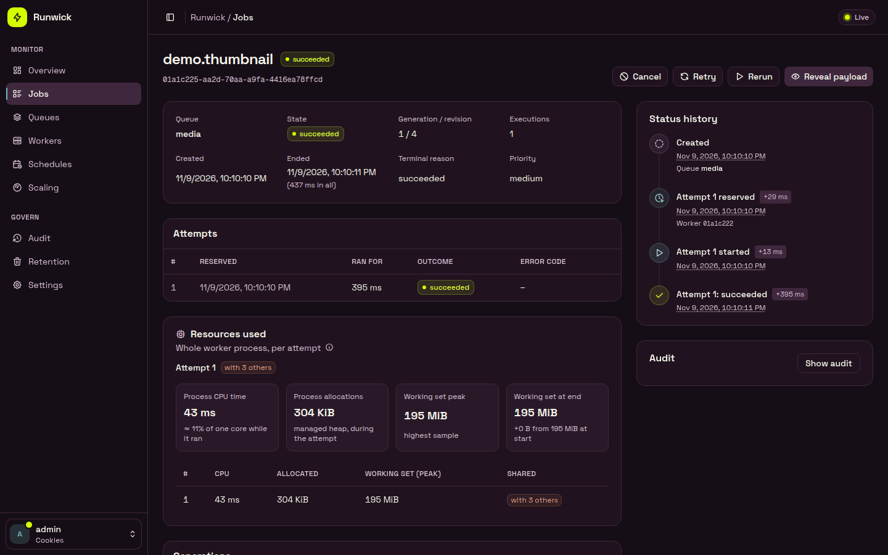

# Runwick

[](https://www.nuget.org/packages/Runwick)
[](https://github.com/adzamkomladev/runwick/actions/workflows/ci.yml)
[](LICENSE)

Runwick is a background-job library for .NET 10. Your app writes a job to a store (PostgreSQL, SQLite or Redis), and a worker picks it up and runs your handler. The worker can run inside your app or in a separate process.

- **Three stores, one API.** PostgreSQL is the reference store, for many hosts. SQLite suits a single machine. Redis needs one durable primary.
- **Honest guarantees.** Delivery is at-least-once, with idempotency keys. Cancellation is cooperative. The one exactly-once case is completing a job in the same PostgreSQL or SQLite transaction as your own work.
- **Schedules, retries, rate limits and uniqueness** are built in. So are queues you can pause, and worker pools with fixed or automatic concurrency.
- **Transactional outbox.** It commits a job together with your business data (PostgreSQL or SQLite source), and then delivers it to any store.
- **Operations included.** There is a management HTTP API, a web dashboard and a `runwick` command line. All three share the same permissions and audit trail.
- **Observable.** It has OpenTelemetry traces and metrics, structured logs, health checks and shipped alert rules.



## Install

```bash
dotnet add package Runwick
dotnet add package Runwick.Postgres   # or Runwick.Sqlite, or Runwick.Redis
```

| You want | Package |
|---|---|
| Job types only, shared with a producer that has no database code | `Runwick.Contracts` |
| Run jobs | `Runwick` plus one store: `Runwick.Postgres`, `Runwick.Sqlite` or `Runwick.Redis` |
| Management HTTP API | `Runwick.AspNetCore` |
| Web dashboard | `Runwick.Dashboard` |
| Metrics and traces | `Runwick.OpenTelemetry` |
| Transactional outbox | `Runwick.Outbox` plus `Runwick.Outbox.Postgres` or `Runwick.Outbox.Sqlite` |
| Test your own code without a database | `Runwick.Testing` |
| Command line | `dotnet tool install --global Runwick.Cli` (command `runwick`) |

Every package targets `net10.0` only. You never need Node or npm, because the dashboard's web files are inside its package.

## Quick start

A job, and the handler that runs it:

```csharp
[JobName("email.welcome")]   // the stored name; CLR type names are never stored
public sealed record SendWelcomeEmail(Guid UserId) : IQueueJob;

public sealed class SendWelcomeEmailHandler : IJobHandler<SendWelcomeEmail>
{
    public Task HandleAsync(SendWelcomeEmail job, CancellationToken cancellationToken)
    {
        // Do the work. Stop promptly when cancellationToken is cancelled. This code may run more than once.
        return Task.CompletedTask;
    }
}
```

Create the schema once, with a role that may create schemas:

```csharp
await RunwickPostgresMigrations.MigrateAsync(connectionString);   // or: runwick migrate --provider postgres --connection-env MY_CONN
```

Register Runwick and a worker:

```csharp
builder.Services.AddRunwick(runwick =>
{
    runwick.Application("my-app")
        .UsePostgres(connectionString)              // or UseSqlite(...) or UseRedis(...)
        .AddJobsFromAssemblyContaining<SendWelcomeEmail>();
    runwick.AddHandler<SendWelcomeEmail, SendWelcomeEmailHandler>();
    runwick.AddWorker(w => w.Pool("main", p => p.Queues("default").FixedConcurrency(4)));   // leave out in a producer-only app
});
```

Dispatch from anywhere, using `IJobDispatcher` from dependency injection:

```csharp
await dispatcher.DispatchAsync(new SendWelcomeEmail(userId));
```

`DispatchAsync` returns only after the store has confirmed the write. If it reports that the outcome is unknown, the write may or may not have happened. [Delivery semantics](docs/guide/delivery-semantics.md) explains what to do.

## Stores

| | PostgreSQL | SQLite | Redis |
|---|---|---|---|
| Server | PostgreSQL 16, 17, 18 | a local file, SQLite 3.38 or newer (bundled) | Redis 8.2 or newer |
| Hosts | many, connected to the primary | one machine | many, all reaching one standalone primary |
| Job in the same transaction as your data | yes | yes | no (use the outbox) |
| Refused at startup | replica or proxy profiles | network share, in-memory, sync weaker than FULL | replica, Cluster, Sentinel, wrong AOF settings |

Runwick checks each store's durability settings when it starts and while it runs, and refuses settings that could lose jobs. For example, SQLite must use WAL with `synchronous=FULL`, and Redis must use `appendfsync always` and `noeviction`. [Which store, which topology](docs/guide/topology.md) has the full list.

## Dashboard and API

```csharp
builder.Services.AddRunwickManagement(m => m
    .AuthenticationSchemes("Cookies")                        // you bring the sign-in
    .MapGrants(principal => ManagementRoles.Operator));
builder.Services.AddRunwickDashboard("default", d => { });

app.MapRunwickManagement("/runwick/api");
app.MapRunwickDashboard("/runwick");
```

There is no anonymous mode. Every request is checked on the server, and changes are written to an audit trail. [Management, dashboard and CLI](docs/guide/management.md) explains it.

## Documentation

1. [Getting started](docs/guide/getting-started.md)
2. [What Runwick promises (and does not)](docs/guide/delivery-semantics.md)
3. [Cancelling jobs](docs/guide/cancellation.md)
4. [Which store, which topology](docs/guide/topology.md)
5. [Configuration reference](docs/guide/configuration.md)
6. [Management, dashboard and CLI](docs/guide/management.md)
7. [Observability](docs/guide/observability.md)

The exact rules are in [docs/spec](docs/spec). The guide is the short version.

## Status

**0.1.0 is the first public release.** The API and storage formats can still change before 1.0. The qualification work for 1.0 is not finished yet:
- the Windows and macOS checks;
- the benchmark on a dedicated reference machine;
- the 24-hour soak test.

Until it is, no store is labelled "certified". The conformance reports are in [docs/conformance](docs/conformance).

## Building from source

You need the .NET SDK pinned in [global.json](global.json).

```bash
dotnet build Runwick.slnx
dotnet test tests/Runwick.Core.Tests
```

Store tests need a PostgreSQL server, either from `RUNWICK_TEST_PG` or a Docker container started by Testcontainers. Redis tests need `RUNWICK_TEST_REDIS`.

## Releasing

Pushing a tag `v<version>` that matches `<Version>` in `Directory.Build.props` runs [the release workflow](.github/workflows/release.yml). It builds and tests, then packs and inspects every package. Then it creates the GitHub release, and publishes to nuget.org through trusted publishing.

## Licence

[MIT](LICENSE). Copyright (c) 2026 Komla Adzam. Runwick's dependencies are MIT or Apache-2.0. The exceptions are the SQLite engine, which is public domain, and the dashboard's two fonts, which are OFL-1.1. See [docs/release/licenses.md](docs/release/licenses.md).
