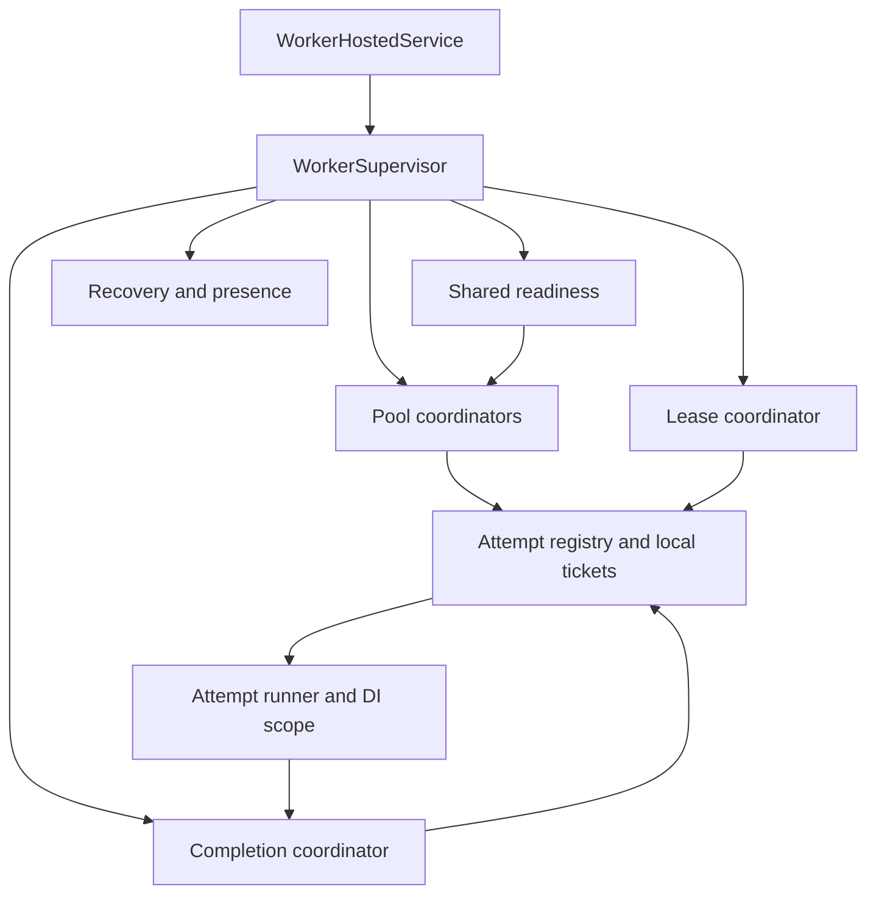

# Worker-engine internals

Status: engineering proposal, 2026-10-28. Planning only; no runtime implementation or executed tests. Read with the [storage protocol](storage-command-protocol.md), [PostgreSQL design](postgres-storage-design.md), and updated [storage review inputs](../storage-design-inputs.md).

Follow-on specification, 2026-10-29: [capacity control](capacity-control.md) now defines the exact selector/controller proposal and extends Begin with rate admission. A committed RateLimited response retires the unstarted local entry without invoking the pipeline; it is not an observational retry of the same still-owned reservation. [Scheduling internals](scheduling-internals.md) specifies the separate materialization role.

## 1. Baseline after the storage review

The updated review accepts the seven-state lifecycle and separate BeginExecution accounting. Carry those forward as this engine's working baseline. It also retains lease-backed distributed permits, string priority lanes, capability-aware reservation, and atomic job-plus-permit admission. This document develops the engine around those choices without changing the public handler signature.

| Review input | Engine disposition |
|---|---|
| One probe across queues and priorities | One coordinated readiness query per compatible polling group, independent of handler count |
| One handler per job name; versions select decoding | Immutable name-keyed registry with validated upgrade chains and derived capabilities |
| Unsupported backlog stays visible | Publish worker capabilities; report unmatched backlog through management queries, not a new job state |
| Queue-wide ceiling should stop cursor walking | Stop the affected queue's lanes when the scope is authoritatively known to cover that queue; bounded cooldown and later recheck |
| Recently observed jobs all share a type | Treat as a cost/backoff hint only; it cannot prove every remaining job has that type |
| Resource-key blocking | Continue from the returned cursor within a small scan budget; retain continuation between passes |
| Rate limits missing | Explicit follow-on storage/engine work before v1 admission controls are complete; not approximated with concurrency or local timers |
| Seed ceilings without replicas overwriting each other | Seed-if-absent; report mismatched code configuration, leave edits to revision-checked management operations |

The review's optional-versus-required name attribute, custom priority labels, numeric defaults, and per-dispatch priority override remain separate contract decisions. The engine uses resolved stable names and configured lanes; it does not settle attribute syntax by accident.

## 2. Runtime ownership

Use one `WorkerHostedService : IHostedService` per configured Runwick worker instance. It owns a `WorkerSupervisor` and all long-lived tasks below. Producer-only registration creates none of them. Embedded and external hosts instantiate the same tree. An explicit hosted-service implementation makes staged stopping independent of a single automatically cancelled execution token. .NET supports both direct hosted-service implementations and BackgroundService. [Hosting reference](https://learn.microsoft.com/en-us/dotnet/core/extensions/workers)

| Internal component | Owns | Must not own |
|---|---|---|
| WorkerSupervisor | Startup validation, unique process ID, critical-task supervision, health, stop sequence | Application job scopes |
| PoolCoordinator, one per configured pool | Target capacity, local tickets, queue/lane selection, cursors, attempt membership | User code execution on its coordinator loop |
| ReadinessCoordinator, shared by compatible pools | One in-flight probe, coalesced wake signal, polling backoff, notification subscription | Durable admission authority |
| AttemptRunner, one per admitted attempt | Decode/upgrade, DI scope, middleware, handler, cleanup, observed outcome | Lease renewal scheduling |
| LeaseCoordinator, shared per worker/store | Due-time queue, bounded renewal I/O, lease-health updates | Handler or scoped-service references |
| CompletionCoordinator, shared per worker/store | Pending immutable outcomes, Finish command retries, receipt resolution | Handler re-execution |
| RecoveryLoop | Bounded expired-lease discovery and Recover commands | Assuming a worker heartbeat proves job ownership |
| WorkerPresenceLoop | Capability snapshot, heartbeat, draining/health telemetry | Extending a job lease |

Each task is registered before it can run, observed for failure, and awaited during normal shutdown. A critical coordinator fault stops new admissions and starts a controlled drain; it must not leave a healthy-looking worker accepting work without renewals. Handler exceptions become attempt outcomes. Telemetry failures degrade observability and retry with backoff; they do not fabricate lease loss.

The scheduler is a separate host role that materializes jobs through dispatch. It is not called by a worker before each reservation.



## 3. Local capacity and execution registry

`LocalCapacityGate` uses an atomic/locked counter with an idempotent ticket, not replacement SemaphoreSlim instances when the target changes. Admission requires `outstandingTickets < target`. Reducing the target stops refilling until existing tickets drain; it cancels no running job. Pool maxima bound memory even if the target is later raised.

A ticket is acquired **before** TryReserve. It remains held through claim resolution, execution, cleanup, and durable finalization or definitive loss of authority. No new durable reservation is queued behind occupied local slots. Slow jobs do not prevent another completed ticket from being refilled.

Two registries share one ownership transfer:

- `PendingClaim` keyed by reservation command ID owns the ticket until a claim resolves.
- `AttemptEntry` keyed by `(application, attemptId)` takes that ticket exactly once after an Applied reservation. It stores the lease handle, pool, immutable policy/registration, invocation latch, task handle, current control command, cancellation causes, observed outcome, and cleanup status.

Use short in-memory synchronization for state changes; never hold a monitor across database I/O or user code. Begin/Renew/Finish for one entry pass through a per-attempt asynchronous control arbiter. It permits one lifecycle command in flight, including resolution of its unknown commit. It never holds a gate across handler execution. Different attempts proceed independently under bounded I/O concurrency.

Every operation completion carries its local operation sequence. A late reply can resolve that operation but cannot overwrite a newer ownership/terminal decision. Once an entry is retired, a late reservation replay cannot recreate it: the command resolver and invocation latch retain disposition until all associated callbacks are joined. A process restart creates a new worker ID and never adopts these old entries.

Local bookkeeping states are separate from durable job states:

| Local phase | Durable relationship | Slot rule |
|---|---|---|
| Claiming / ResolvingClaim | May have no job, or an unobserved committed reservation | Keep ticket; do not issue another claim for it |
| Reserved / Beginning | Exact reserved lease | Resolve begin before another control command; renew between resolved commands; invoke nothing yet |
| Executing / CleaningUp | Normally running | Keep ticket and renew while authority remains |
| AwaitingFinish / ResolvingFinish | Outcome known locally; durable state may already have changed | Keep ticket; never invoke again |
| OwnershipLost | Store rejected ownership or local lease-safety deadline elapsed | Cancel user work; retain ticket while any user task/cleanup is alive |
| Retired | All local work ended; durable result resolved or authority relinquished | Release ticket exactly once |

Keeping pending completions inside ticket capacity deliberately reduces throughput during storage outages. It prevents an unbounded queue of successful handlers awaiting acknowledgement. A future separate completion-capacity budget needs its own measured memory and lease guarantees.

## 4. Startup, handler registry, and payload compatibility

Startup validates registration, middleware ordering, policy bounds, schema compatibility, and configuration before enabling admission. Publish the worker's initial capability snapshot, then start readiness, renewal, completion, recovery, and pool tasks under the supervisor. Do not instantiate scoped handlers to build the registry.

Preserve `IQueueJob`, `IJobDispatcher.DispatchAsync`, `IJobHandler<TJob>.HandleAsync(job, CancellationToken)`, and optional injected `IJobContext` as the current public baseline. Internal dispatch uses a cached typed invoker; reflection, if needed, occurs during registration rather than on each execution.

`JobRegistration` is keyed by stable `job_name` and contains:

1. Current payload version and current CLR payload type, plus the one handler factory.
2. Explicit immutable serializer profiles and historical payload decoding types.
3. Ordered adjacent-version upgrade delegates leading to the current type.
4. Immutable effective job settings and a cached middleware composition factory.

Reject duplicate names, missing upgrade steps, cycles, ambiguous handler bindings, and incompatible types at startup. Following the [identity/serialization decisions](identity-and-serialization.md), advertise `(name, payloadVersion, serializerProfileId, serializerProfileVersion)` only when a complete decode/upgrade path exists. Upgrades are deterministic transformations with no external I/O, scoped service capture, or durable side effects. Preserve original UTF-8 bytes/profile on read. A new worker can drain old payloads; an old worker cannot reserve an unsupported version or profile.

Execute decoding/upgrades only after Begin commits, under the execution budget. Malformed JSON or deterministic conversion failure becomes a permanent payload failure via Finish. Infrastructure/transient handler failures use the configured classifier. If the registry somehow cannot resolve a contract it advertised, stop affected admissions as a configuration/invariant fault; do not silently discard jobs.

Worker presence contains process ID, application, subscribed queues, capability revision and full decoding tuples, pool targets, build identifier, status, and heartbeat expiry. Capability changes require a new registration revision; the first implementation freezes the registry for a process lifetime. Management compares backlog tuples against fresh worker capabilities **and queue subscriptions**. Its result means “no recently advertised capable worker,” not proof no worker could execute the job. Presence expiry does not recover job leases.

## 5. Readiness, lane selection, and saturation

The readiness interface is a proposed read-side addition; it does not change reservation authority:

```csharp
internal sealed record LaneKey(string Queue, string Priority);
internal sealed record ReadyLane(
    LaneKey Lane,
    DateTimeOffset OldestEligibleAt);
internal sealed record ReadySnapshot(
    DateTimeOffset ObservedAt,
    IReadOnlyList<ReadyLane> Lanes);

internal interface IWorkReadinessStore
{
    Task<ReadySnapshot> ProbeAsync(
        string application,
        IReadOnlyList<LaneKey> lanes,
        IReadOnlyList<JobContract> supportedContracts,
        CancellationToken cancellationToken);
}
```

PostgreSQL shape: pass bounded paired queue/priority arrays as a lane relation; for each lane use a lateral ready-index lookup with the same supported-contract predicate, selecting the first eligible row ordered by `(eligible_at, job_id)`. Return only nonempty lanes and one database observation time. This is **one round trip**, not a claim of constant work: it still performs up to one indexed lookup per requested lane and can scan unsupported rows. It acquires no reservation locks, counts no full backlog, and fetches no payload. Queue-paused lanes can be excluded in this observation, but TryReserve must still check the control row.

Group pools by application/store and compatible capability sets; share a probe for their union of lanes. Filter the cached result back to each pool's subscriptions. A stale/nonempty hint can legitimately lead to NoWork. Missing notifications are repaired by periodic polling. A single bounded wake signal coalesces notifications, local dispatch commits, slot releases, and control changes; it does not allocate one task per notification. Reconnect/resubscribe triggers a fresh probe. Idle polling uses capped backoff and per-process jitter, reset on actual work or a useful wake hint.

Lane choice has two levels: weighted round-robin/deficit accounting between eligible queues, then weighted lane selection within the chosen queue. Charge one unit for an Applied reservation, not its execution duration. Thus weights represent admission opportunities, not CPU fairness. Carry bounded credits between rounds and cap accumulation while a lane is empty/blocked. A strict-priority option can starve lower lanes unless aging is enabled; document that interaction. Aging increases selection opportunities based on oldest eligible age, without rewriting persisted priority. Exact weights and aging thresholds belong to the scheduling/capacity specification.

For each opportunity:

1. Obtain a local ticket; select an observed-ready lane and its retained cursor.
2. Send a single Reserve command. Resolve that command before changing its arguments or choosing a new command ID.
3. Applied transfers the ticket to the attempt entry. NoWork resets that exhausted cursor and invalidates the lane hint; QueuePaused backs off the whole queue.
4. CapacityBlocked advances `After` to the supplied cursor. If the known scope covers the whole queue, cool down all its lanes. If a lane is explicitly configured as single-type, a full type scope can cool down that lane. Recent examples alone are insufficient proof.
5. For resource or unknown scopes, continue in new transactions within the scan budget. Retain the cursor across rounds; wrap at the end. Polling/cooldown eventually rechecks older skipped candidates and newly eligible jobs before the cursor.

Proposed tuning baseline: at most **8 blocked candidates per lane visit** and **32 reserve attempts per pool scheduling round**, counting successful claims too. Yield between rounds and respect local slots plus a separate bounded claim-I/O limit. These numbers are tunable starting values, not performance claims. A blocked lane gets a positive cooldown, so repeated wake signals cannot create a tight scan loop. Cooldowns are bounded hints; pause/control changes, local release, and periodic expiry can trigger a recheck.

The existing `BlockedScopeId` needs a bounded cache of scope metadata (kind, key, revision) from the driver/control layer. An unknown or stale association falls back to bounded scanning; it never authorizes a whole-lane exclusion indefinitely. Full-scope hint tables remain deferred until measurements justify them.

Local resource-key gates are not in the first engine path: the current pre-reservation probe does not reveal keys, and waiting for a local gate after reservation holds durable permits unnecessarily. Add them only with a concrete candidate-hint contract and safe holder/waiter reclamation, not merely because another library uses them.

## 6. Attempt execution and middleware

The runner follows this order:

1. Register the reserved lease for renewal and retain the exact registration/policy snapshot. Check remaining authority before Begin; renew first if its safety margin is inadequate.
2. Issue Begin through the control arbiter. Resolve unknown commits using the same ID. A cancellation-before-start result closes the reservation without creating a handler scope.
3. After ambiguous reserve/begin resolution, perform a fresh ownership-checked renewal, inspect cancellation, and verify sufficient lease margin. A replayed result alone never authorizes invocation.
4. Atomically latch local invocation once. Record the local execution-start timestamp and schedule the runner on the shared thread pool, without passing a cancellation token that could prevent its bookkeeping/finally from running. Recheck authority and pipeline timeout before executing setup/user code after queueing; a counted Begin is not permission to ignore a later loss. The execution cancellation token is supplied inside the runner.
5. Decode and upgrade payload; create one async DI scope; initialize its scoped context before resolving middleware or the handler.
6. Run the cached pipeline factory with per-attempt instances. Capture observed outcome and monotonic elapsed time when the pipeline ends.
7. Dispose the scope asynchronously after all awaited middleware/handler work ends. Track cleanup independently from the frozen pipeline outcome.
8. Publish an immutable Finish request; retry only storage finalization, never this pipeline. Release the local ticket only when the registry retirement conditions hold.

Scheduling the runner away from the coordinator prevents a handler's synchronous prefix or constructor from directly blocking the coordinator loop. It does not isolate CPU usage or prevent process-wide thread-pool starvation. No dedicated thread or process is allocated per job. Require awaited work; tasks detached by application code are outside the engine's lifetime guarantee.

The scoped context exposes job/attempt/generation IDs, queue/priority, original and current payload versions, upgraded payload access, trace metadata, cancellation causes, and resource fencing values. Its metadata is read-only; a scoped Items collection belongs to that attempt. It contains no database connection, mutable lease authority, or ability to call Finish. Never capture context or scoped services in the cached pipeline. Hosted services do not receive scopes automatically; explicitly create and dispose each attempt's async scope. [Scoped-service reference](https://learn.microsoft.com/en-us/dotnet/core/extensions/scoped-service)

Proposed internal continuation contract:

```csharp
internal enum PipelineDecision { Succeeded, Retry, Failed, Cancelled }
internal sealed record PipelineResult(
    PipelineDecision Decision,
    string? ReasonCode,
    TimeSpan? RetryDelay,
    AttemptError? Error);
internal delegate ValueTask<PipelineResult> JobContinuation();
```

Global middleware wraps per-job middleware, which wraps the handler; registration order defines outer-to-inner order. The terminal handler returns success if HandleAsync completes normally. Middleware may call/await `next` exactly once or explicitly short-circuit with a result; success without invoking the handler is an intentional successful handling decision. Calling next twice, calling it after the middleware returned, or returning while it is still running is a pipeline contract fault. A guard prevents a second invocation, cancels on misuse, and joins any already-started downstream task before disposing its scope. This can still hang if user code ignores cancellation.

Retry delay requests are validated and capped against policy; middleware cannot extend lease authority, reset the execution budget, or suppress a latched timeout. A Cancelled result is a deliberate user cancellation; unrelated OperationCanceledException without an engine cancellation cause follows exception classification rather than automatically reporting durable user cancellation.

Cleanup exceptions are recorded separately and do not turn an already successful handler into an automatic retry. If cleanup hangs, keep the scope and local ticket, mark the worker degraded, and apply the bounded cleanup/renewal budget. Do not dispose services concurrently with active user code or release permits merely because a timeout task won a race.

## 7. Renewal and lease safety

The lease scheduler uses one due-time priority queue with one current scheduled item per attempt, a timer, and bounded independent renewal requests. Avoid unbounded stale heap entries when rescheduling. Prioritize leases nearest their safety deadline over new reservation I/O; reserve driver connection/I/O headroom for renewals and finalization. Final pool/connection budgets must be validated together.

For a fresh non-replayed response, let `s` be the local monotonic timestamp immediately before sending the command and `r = ExpiresAt - DecidedAt` be its remaining database lease at decision. A conservative local safety deadline is `s + r - safetyMargin`, checked again when the response arrives. This subtracts all round-trip delay without depending on agreement between worker and database wall clocks. A historical replay cannot establish that deadline; obtain a fresh renewal first. Database expiry checks remain authoritative; database clock jumps can invalidate local estimates.

Use monotonic timestamps for elapsed durations and renewal scheduling. `TimeProvider.GetTimestamp/GetElapsedTime` supports this and deterministic clock substitution; the user-selected minimum is now .NET 10. [Elapsed-time reference](https://learn.microsoft.com/en-us/dotnet/api/system.timeprovider.getelapsedtime?view=net-10.0)

The [timing packet](execution-defaults-and-timing.md) now proposes a 60-second lease, 10-second safety margin and renewal at 15 seconds with bounded jitter, replacing the earlier approximate one-third interval. Validate request/retry/scheduler headroom and actual remaining authority. Cleanup/resolution can span successful renewals; they need not fit within one lease. If returned margin is inadequate, renew before invocation; if authority cannot be confirmed, do not start.

Begin, Renew, and Finish share the per-attempt arbiter. Before starting another control command, resolve any unknown result; do not interpret a stale renewal after a possibly committed Finish as proof the job failed. Keep each operation timeout short enough to leave renewal margin. Transport batching, if added, preserves independent command IDs and lease outcomes, as required by the storage protocol.

A transient renewal error can retry within the last confirmed safety window. A stale response or elapsed safety deadline latches ownership loss and requests handler cancellation. Once latched, do not revive that attempt locally even if a delayed response later reports an extension. Stop renewing and never submit a new Finish for its late handler result. A previously sent Finish may still be resolved from its receipt. Keep observing/cleaning up live user work and retain its local slot.

The safety-deadline watchdog does not wait behind the control arbiter or a hung database request. It may latch loss while such a request is still unresolved; subsequent replies are handled as historical results, with Finish receipt resolution still permitted. No local timer itself proves that PostgreSQL expired the lease.

Cancellation callbacks are user code: dispatch cancellation off the lease scheduler, track it, and observe callback exceptions. Slow callbacks must not hold up unrelated renewals. This provides task separation, not a guarantee against global thread-pool starvation.

## 8. Completion, outcomes, and bounded uncertainty

There is at most one frozen completion per entry. Use a bounded ready-ID channel with waiting/backpressure for completion work; never drop outcome messages. The authoritative pending outcome remains on the entry until acknowledged. A bounded worker set processes ready IDs and retries with backoff; it does not allocate an unlimited sleeping task per failed write. Coalesced wake notifications may be dropped because registry scanning recovers them. Bounded channels provide explicit waiting and dropping modes; select them according to whether the message is authoritative or a hint. [Channel reference](https://learn.microsoft.com/en-us/dotnet/core/extensions/channels)

Pipeline timeout starts at local invocation admission, including thread-pool delay, decoding, upgrades, DI activation, and middleware. It excludes time resolving Begin, scope disposal after the pipeline ends, and storage acknowledgement. Capture elapsed time once when the pipeline ends. A pipeline that returns after its timeout is TimedOut even if it ignored cancellation and returned normally; a timely success does not become timed out because Finish is slow.

| Observation | Engine action |
|---|---|
| Timely normal completion / explicit successful short-circuit | Finish Succeeded |
| Explicit permanent failure or deterministic malformed payload | Finish PermanentFailure |
| Retry decision or classified transient exception | Finish RetryableFailure with bounded optional delay |
| Pipeline exceeded execution timeout | Request cancellation; Finish TimedOut only after user work/cleanup ends and while still owner |
| Cooperative drain cancellation ends execution | Finish Interrupted, unless a timeout or durable user cancellation determines the result |
| Durable cancellation observed, execution unsuccessful | Finish with observed cause; storage applies its cancellation precedence |
| Ownership lost | Cancel/observe; no new Finish, leave takeover/recovery to storage |

Keep cancellation causes separately (user, timeout, shutdown, lease loss) instead of inferring all of them from one linked token. Storage still resolves the final cancellation/success race under its job lock. Timely success may win a concurrent user request; local timeout cannot be erased by middleware. The engine does not repeat budget arithmetic already owned by storage.

Unknown Finish commit: retain command ID and exact frozen body, resolve receipt/retry, and never rerun the handler. Once Applied is confirmed, stop renewal and retire after cleanup. Definitively stale ownership retires without overwriting the stored outcome. A receipt that expired before resolution leads to history inspection and an explicit unknown-durability diagnostic, not an invented success/failure.

Use bounded claim/Begin/completion resolution, cleanup and cancellation-grace budgets from the timing packet. Its numbers remain unvalidated recommendations. Cancellation-grace expiry with live pipeline work, or cleanup-budget expiry with live disposal, stops renewal and latches abandonment without freeing the ticket/scope. Completion-resolution expiry similarly leaves durable recovery to lease expiry and reports unconfirmed outcome. Retire only after user work ends and issued commands are resolved or their transactions are known to have ended, with ambiguity recorded. NotAfter passing alone does not prove an earlier transaction failed: it may have decided before the deadline and committed later. Continued commit ambiguity suspends that pool's admission rather than accumulating unresolved entries.

An unknown reservation holds its ticket and reuses its command ID. If its resolution budget expires, suspend admissions for that pool and surface the unresolved claim. Do not create an unlimited succession of orphan reservations. Shutdown may leave its eventual expired reservation to recovery; it cannot mark an unknown claim as completed.

## 9. Shutdown and cancellation-resistant handlers

Use separate lifetime controls: admission stop, per-attempt execution cancellation, and control-I/O shutdown deadline. Do not pass the already-cancelled host stopping token to Finish or to renewals needed during drain.

1. **Stop admission:** atomically close ticket acquisition and new Reserve issuance; publish draining status. Cancel/wake idle probes. A reservation already in flight stays tracked even if its response arrives during stopping.
2. **Resolve claims, then release unbegun reservations:** finish bounded command resolution. For every confirmed reserved-not-begun attempt, issue `ReleaseReservation` (accepted 2026-10-30, R2): an ownership-checked command that closes the attempt as `released`, deletes its exact permits, restores the job's prior waiting state and charges neither execution nor abandonment budget. Its reply is handled like Finish: retained command ID, receipt resolution on an unknown reply, never a fresh ID. Do not manufacture a user cancellation or Begin merely to release a reservation. If the release cannot be confirmed within the drain budget, stop renewing and let expiry recovery apply the guard — that is now the exception path, not the normal one.
3. **Graceful drain:** allow already-begun executions to finish until the drain deadline. Continue renewal, completion writes, and task observation.
4. **Request cancellation:** at the drain deadline, cancel remaining execution tokens and allow a bounded cleanup period. Finalize cooperative exits with their actual outcome while authority remains.
5. **Stop control I/O:** at the overall shutdown deadline, stop renewal/recovery/presence work, cancel remaining I/O, observe available results, and return from StopAsync within the host's bound. Mark any remaining ownership/outcome as unresolved; never acknowledge running code just to empty the registry.

Noncooperative handlers or disposal can outlive StopAsync. The library cannot safely terminate them or guarantee continued DI availability after the host disposes its provider. Retain their local records while the process lives, observe eventual task faults, expose stuck-worker health, and rely on external process lifecycle for a hard stop. During ordinary operation, such a task continues occupying its local slot even after lease loss, preventing unbounded replacement tasks. Distributed permits still expire and another process may retry; external side effects need application idempotency/fencing.

Shutdown budgets must fit the host and deployment termination grace period. Tests must cover host interruption before each phase completes; abrupt process death skips this sequence and is handled by durable leases.

The timing packet proposes absolute 15/20/25-second cutoffs from the first observed stop signal, with host cancellation taking precedence. Starting StopAsync later does not reset them. Ordinary claim/grace/cleanup/completion allowances are bounded by the remaining shutdown time; no host-wide settings are overwritten automatically.

## 10. Storage additions and explicit deferrals

These additions are required by this engine proposal but do not silently alter the existing mutation protocol:

| Item | Required follow-up |
|---|---|
| Multi-lane readiness | Add read-side interface/query and query-plan tests; preserve original Reserve checks |
| Scope metadata | Bounded revisioned lookup for blocked-scope classification; seed-if-absent provisioning and mismatch diagnostics |
| Worker presence | Schema/read-side contracts for capability revision, subscriptions, heartbeat expiry, health; independent of job ownership |
| Headers/context | ReservedJob currently lacks trace/application headers from job_payloads; add a bounded immutable metadata projection or explicit payload read before implementing propagation |
| Rate admission | Now specified by the [capacity design](capacity-control.md); reconcile its versioned Begin/defer result, grant records, lock order and receipt/accounting rules before implementation. Implement after the first execution milestone and before v1 admission controls are complete |
| Neutral reserved release | `ReleaseReservation` accepted into SP-008 (R2, 2026-10-30); the engine issues it during drain and falls back to expiry recovery only when it cannot be confirmed |

Rate limits cannot be derived from permit counts. The capacity proposal chooses Begin authorization as the accounting point and atomically relinquishes permits on committed deferral. This bounds authorization grants in the window, not the precise instant of a downstream side effect. Do not add a reservation counter while claiming the Begin contract. No process-local limiter may stand in for a distributed promise.

Durable ceiling edits remain revision-checked management operations. Code seeds missing configuration, never overwrites existing capacity on every restart. Dynamic keyed scopes need bounded lifecycle rules before adding local caches; resource fencing counters retain their existing persistent identity.

## 11. Validation and measurements

Use deterministic engine tests with fake time, controllable storage replies, and task barriers; pair them with the real PostgreSQL race tests. Engine tests prove task ownership and sequencing, not SQL isolation. No tests in this table have been implemented or run.

| Scenario | Required assertion |
|---|---|
| One slow handler among fast ones | Each retired ticket refills independently; no batch-wide wait |
| Target reduction with in-flight claims | Outstanding tickets may exceed new target; no new tickets until below it |
| Lost Reserve/Begin reply, delayed duplicate response | Same command/attempt; one scope and at most one local invocation |
| Shutdown while Reserve commits | Returned claim remains tracked; no new handler starts after admission closes unless Begin was already authorized and drain policy permits it |
| Synchronous handler prefix / blocking constructor | Not executed inline on pool or lease coordinator; starvation separately observable |
| Renewal deadline during slow pipeline | Renewal is independent; uncertain authority cancels and never revives the local attempt |
| Finish commits, reply lost, renewal becomes stale | Resolve Finish; never misreport stale renewal as a new failed execution |
| Storage outage after handler success | Pending outcomes and tasks stay bounded; no invocation replay; admission backs off |
| Timeout ignored by handler | No premature scope disposal, permit release, or local slot replacement; late result cannot claim timely success |
| Slow/throwing cancellation callback | Other leases continue; callbacks and their faults are tracked |
| Scoped service isolation and async disposal | One scope per attempt, initialized context, no cross-attempt service capture |
| Middleware calls next twice / returns early | No second handler call; downstream task joined before disposal |
| Upgrade v1→v2→v3, gap and malformed payload | Capabilities include only complete paths; original payload unchanged; failures observable |
| Mixed-type lane under type ceiling | Later unblocked type remains discoverable despite repeated earlier blocked type |
| Queue ceiling with 10k waiting jobs | Bounded scan/probe work, rather than one blocked transaction per job per poll |
| Dropped/coalesced notifications and reconnect | Polling eventually discovers work; no duplicate invocation |
| Scope cleanup throws after timely success | Diagnostic preserved; no automatic rerun of successful handler |
| Host dies at each shutdown phase | Lease recovery remains possible; no false durable acknowledgement |
| Presence expires while job lease is healthy | Dashboard uncertainty only; job ownership unchanged |

Measure idle queries versus queues/lanes/replicas, blocked reserve calls per poll, claim/renew/finish p95/p99, missed renewal margins, thread-pool delay, memory per outstanding attempt, receipt writes, scope-lock wait, and drain latency. Preserve the storage review's 1/3/6-replica queue-ceiling tests and WAL-per-renewal measurements. Unsupported backlog should have a dedicated query-cost test before adding indexes.

## 12. Implementation order after architecture review

1. Immutable registration/upgrade validation, local ticket gate, registry state machine, fake-time harness.
2. Pool/readiness coordination and bounded lane scans against controlled replies.
3. Begin/runner/DI/middleware lifecycle and exact invocation guards.
4. Renewal scheduling, per-attempt command arbiter, receipt ambiguity, bounded finalization.
5. Drain/cancel/cleanup supervision, presence diagnostics, and real PostgreSQL process tests.
6. Contention/load measurements, then justified batching or notification optimizations.

Scheduling/capacity, drivers, public API, management/observability and the backlog are drafted. The [timing packet](execution-defaults-and-timing.md) proposes defaults/TIME cases; [PostgreSQL integration](postgres-schema-and-operations.md) and [upgrades](postgres-upgrades-and-compatibility.md) define transaction gates and version compatibility. The [provider plan](provider-dependency-plan.md) selects Npgsql, while [capacity defaults/budgets](capacity-defaults-and-budgets.md) now proposes group limits, claim/renewal/settlement I/O partitions, pressure gates and CAP cases. Runtime validation, tuning and the optional neutral reservation-release command remain outstanding. Handler shape and deployment modes remain unchanged.

## 13. Relationship to the implementation research

This design applies the pinned [upstream implementation review](../implementation-research.md): Hangfire's coordinated idle polling informs shared readiness; FastEndpoints' free-slot refill and separate shutdown bookkeeping inform tickets and staged drain; TickerQ's key-lifetime work constrains any later local gate; Wolverine's persistence-failure lesson informs honest durable-result reporting; Quartz's provider-specific contention findings require real PostgreSQL measurements. Coravel's local exclusion does not supply Runwick's distributed limits. These are adaptations and test obligations, not claims that upstream libraries implement this complete design.
