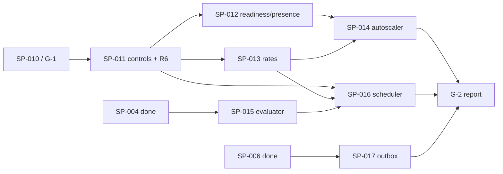

# Runwick: plan for M3 — distributed controls, capacity, scheduling and outbox (SP-011 – SP-017)

> **Draft, 2026-10-31.** Not approved. Written while the SP-010 G-1 measurement run is still in progress, so it decides nothing that depends on the G-1 report (see "Inputs pending from G-1"). Nothing here is normative: `docs/spec/` stays the single normative source (spec 00 §2), and `docs/v1-delivery-plan.md` stays the authority for what is scheduled when.

## Context

SP-002 … SP-009 are implemented, committed and tagged (`sp-002` … `sp-009`), each with an acceptance report under `docs/reports/`. SP-010 (end-to-end tests, workloads, G-1 report) is finishing in another session, which owns its code, commits, the `sp-010` tag and `docs/reports/sp-010-g1.md`.

What is known from G-1 so far, pending the report:

- Every correctness case run so far passes.
- On this shared, CPU-starved host (load ≈ 15 on 8 vCPU, sp-009 report), throughput is about 0.5–2 jobs/s against the 100/s D-14 target for P-01.
- The cause attributed so far: about 10 round trips per ownership command (BEGIN, timeouts, gates, receipt, body, receipt finalization, COMMIT; spec 07 §2.5 change 2026-10-30), no prepared statements, and the serial claim per pool (claim concurrency 1, prefetch 0).
- A threshold miss does not fail G-1 (spec 07 §14.1). Only a correctness violation does.

This plan covers backlog §4 (`docs/implementation-backlog.md`) and delivery-plan §5 (`docs/v1-delivery-plan.md`): milestone **M3**, gate **G-2** (`docs/architecture-acceptance.md` "G-2"). The parallel spikes SP-018 (Redis) and SP-023 (Inertia) also belong to M3 in the delivery plan. They are out of scope here and need their own plan.

### Settled design M3 must honor (do not reopen)

Each line names its normative home. The design is reopened only for a concrete contradiction, a failed test or a measured budget miss, and every change is recorded in `docs/spec/*` with a date.

- **Controls.** These transitions are already reserved in spec 03 §5.2:
  - T17 Cancel of `pending`/`retrying` → `cancelled`.
  - T22 Cancel of an owned job records `cancel_requested_at` only. It never releases permits on the assumption that the handler stopped.
  - T18 ManualRetry `failed`/`cancelled` → `pending`, as a new generation `manual_retry` that reacquires the active key.
  - T19 RerunSucceeded `succeeded` → `pending`, as a new generation `rerun_succeeded`.

  Cancel already wins in the Begin/Finish/Recover/ReleaseReservation precedence tables (03 §6.4, §6.5). Queue pause blocks Reserve, never Dispatch, Begin, Renew or Finish (03 §5.2, ADM-04).
- **Transactional completion (R6).** The `StagedCompletion` / `IPostgresJobCompletion.CompleteInTransactionAsync` shape and its handler and middleware forms are in spec 01 §16. It runs Finish/1 `Succeeded` on the caller's connection, after the caller's locks. It is the only exactly-once claim, and only for same-database effects.
- **Rates.** Exact rolling-window count of Begin authorizations, all-or-none across at most 8 rate scopes per generation (capacity-control §3–§4, capacity-defaults §3):
  - The lock rank is "rate scopes", after concurrency scopes (04 §5).
  - Logical rate time is `t = max(db time, last_decision_at)`.
  - A committed `RateLimited` deferral (T20, `admission_deferred`) charges neither budget, releases permits and keeps its receipt.
  - The defer interval is at least 250 ms, plus 0–100 ms jitter, persisted in the receipt.
  - A semantic edit freezes the scope for one full new window. An identical edit does not.
  - Bounds: 1–100,000 per window; window 1 s–24 h.
  - Activation goes through capability `rate_admission`. M2 binaries are already rejected by the gate for creation paths (03 §6.3, §10.3).
- **Readiness and fairness.** Two-level smooth weighted round robin, lanes 6:3:1, aging at ≥ 60 s after 8 admissions, 8 blocked candidates per lane visit, 32 Reserves per round, idle/cooldown backoff F-10 (05 §8, 06 §1.5, 07 C-2). Presence is never authority (00 §9 rule 11). Heartbeat 5 s ±10 %, expiry 20 s in store time (capacity-defaults §4).
- **Autoscaler.** Occupancy plus allocated due backlog, DrainHorizon 30 s, utilization 0.80, EWMA α = 0.20, 3 samples to grow and 6 to shrink, 30 s cooldown, step `max(1, ceil(0.25·current))`, the **R4 boundary rule**, pressure freezes, and scale-down by stopping refill only (capacity-defaults §4–§5).
- **Scheduler.**
  - Cron: `runwick.cron5.v1` / `cron6.v1`, Cronos 0.13.0 OR-union adapter, NodaTime 3.3.7 with a pinned, hashed TZDB artifact (scheduler-evaluator §1–§4).
  - Occurrence identity is `(application, schedule_id, kind, key)`. It never includes the definition revision.
  - Atomic occurrence + jobs + cursor + receipt in one transaction, with plans computed outside locks (scheduling-internals §3–§4).
  - Default misfire is run-once with grace 60 s (equality counts as misfire). Catch-up is ≤ 32 jobs per transaction and ≤ 1,000 per episode, 7 days max. Resume defaults to skip-paused.
  - Schedule lock order: command → schedule → dispatch keys → new jobs → scope families.
- **Outbox.** Three identities: source message, destination delivery, transport command. `ReceiveOutbox/1` has its own lock rank *before* dispatch keys. AcceptUntil = staged + 7 days (30-day max), and the destination mapping is kept to AcceptUntil + 24 h. Relay budgets: 4 in flight, 60 s source lease, 15 s renewal, 5 s per call, 2 source connections per relay group (transactional-outbox; storage-command-protocol "Outbox destination extension").
- **Command lifetimes.**
  - Administrative mutations: 5 min NotAfter, receipts kept to NotAfter + 24 h.
  - Scheduler commands: 30 s, NotAfter + 24 h.
  - Outbox transport: 30 s (03 §8.4; management-retention-defaults "Command lifetimes").
- **Audit.** A successful administrative mutation and its `management_audit` row commit together with the receipt. A replay writes no second audit row. A rejected command writes no success audit (management-and-dashboard §4).
- **Unchanged M2 rules.** Lock order, fresh `clock_timestamp()` after locks, receipt protocol R1–R4, the three answers to "did my write happen?", and the honesty rules (00 §9).

### Doc contradictions to resolve while extracting the M3 specs

The spec wins over history. Between history documents, the later or closure document wins (architecture-baseline).

1. **RerunSucceeded placement.** Backlog §6b puts `RerunSucceeded` (and `job_generations.created_reason`) in SP-031. Spec 00 §3, spec 03 §11 and delivery-plan SP-011 put it in SP-011. → **SP-011**. `created_reason` already exists since SP-005 (04 §4). SP-031 keeps only the rest of its list.
2. **SP-011 scope.** Backlog §4 SP-011 omits the "versioned event schema + keyset events-since-cursor" that delivery-plan SP-011 includes. → Included in SP-011, because the delivery plan is the schedule authority (00 §2.3).
3. **SQLite twin of transactional completion.** Backlog SP-011 says "`CompleteInTransactionAsync` for PostgreSQL/SQLite", but no SQLite provider exists before SP-019. → PostgreSQL in SP-011. The SQLite twin is an SP-019 obligation. This needs confirmation (open question Q3).
4. **SP-012 acceptance wording.** The backlog lists bounded idle probe, saturation, mixed lanes and presence expiry. The delivery plan lists CAP-01–04 and a 10k blocked backlog. 07 §3 defers WRK-15/WRK-19 and driver-suite:OBS-01 to SP-012. → The union of all three.
5. **SP-013 cases.** Backlog: RATE-01–04 and CMD-06. Delivery plan adds CAP-05 and PGX-03. 07 defers the TIME-06 rate sub-part to SP-013. → The union.
6. **Edit-freeze status.** capacity-control §4 calls the policy-edit freeze "a proposal to review"; capacity-defaults §3 recommends keeping it, and D-07 closed at G-0. → Settled. Recorded in spec 10 as normative, not reopened.
7. **Aging inequality** is already resolved (07 C-2: `≥ 60 s`). Spec 09 restates it; no new decision.

### Implementation choices the docs leave open (flagged; proposed here)

- **Spec files 08–15**, one subject per file (Step 1). They follow the 00 §2.4 rule: a subject-specific file wins for its subject.
- **Migration numbering.** Each SP adds its own numbered migration with a cumulative manifest (04 §8.4–§8.6). Numbers are assigned in **merge order**, not SP order, because SP-011/015/017 and SP-012/013 run in parallel. Nothing has been released, so renumbering before merge changes no deployed checksum.
- **Capability names fixed up front**, so parallel items do not collide: `controls`, `transactional_completion`, `readiness_v2`, `rate_admission` (already reserved), `pool_controls`, `scheduler`, `outbox_destination`. Each is activated by `ActivateCapabilities/1` (04 §8.6) on the admin role.
- **Inferred case IDs** where a backlog acceptance bullet has no source ID, as 07 I-2 did for G-1. Spec 15 defines them; all are flagged as inferred.

  | Inferred ID | Item | What it covers |
  |---|---|---|
  | `TXC-01` … `TXC-06` | SP-011 | Transactional completion |
  | `CTL-01` … `CTL-05` | SP-011 | Revisioned controls not covered by END/MGMT |
  | `EVT-01` … `EVT-02` | SP-011 | Event cursor |
  | `MODE-01` … `MODE-05` | SP-011, SP-012 | The five deployments |
  | `RDY-01` … `RDY-03` | SP-012 | Readiness/presence bullets without IDs |
  | `SCL-01` | SP-014 | R4 trace |

- **Control surface in M3.** The storage operations land in M3. The public transport-free services (`IJobControl`, `IQueueControl`, `ICapacityControl`, `IScheduleControl`, reserved in 01 §18) are proposed as **public core services marked preview**, taking an explicit trusted `ManagementActor`, with no HTTP. Authorization stays in SP-020. This is a product question (Q1).
- **Test projects.**
  - `tests/Runwick.Outbox.Tests`: Contract/Fault, for both source adapters.
  - The scheduler evaluator lives in `Runwick.Core.Tests` (Pure).
  - Scheduler storage lives in `Runwick.Postgres.Tests`.
  - Traits are unchanged: `Category`, `Item=SP-0NN`, `Case`, `RequiresDocker`.
- **Workloads.** `tests/Runwick.Workloads` gains `P-04`, `P-05`, `P-06`, `P-09` and the G-1 measurement reruns. `eng/run-g2.sh` mirrors `eng/run-g1.sh`.
- **G-2 report.** `docs/reports/g2.md` is assembled after the last of SP-014/016/017 from the per-item reports. There is no new SP number (Q8).

## Inputs pending from G-1 (left open)

`docs/reports/sp-010-g1.md` is being produced now. This plan does **not** decide any of the following; it records what each decision changes.

### 1. G-1 pass or fail

| Outcome | Effect on this plan |
|---|---|
| Pass | SP-011 may start (its only dependency is SP-010). The rest follows the dependency graph below. |
| Fail on a correctness case | The fix returns to the owning SP item (rule: a failed test reopens its decision). SP-011, and everything behind it, waits for a re-run G-1. Unaffected: spec drafting (Step 1), SP-015 (depends on SP-004 only). SP-017 (depends on SP-006 only) proceeds only if the failure is outside the dispatch path. |
| Pass with threshold misses | No effect on gating (07 §14.1). Feeds decision 2 below. |

### 2. Whether SP-031 round-trip reduction moves earlier

07 §14.6 items 3–6 require the report to state:

- `t_reserve`, `t_begin` and `t_finish`;
- the slot-bound ceiling;
- `C_claim = 1 / t_claim`;
- which bound limited P-02;
- whether `ReserveAndBegin/1`, batched Reserve and batched Renew are justified, with the expected gain.

**Decided 2026-10-31 (user): option A.** All performance work waits until M3 is done (G-2 passed); nothing moves into M3, including option D. M3's new operations use the current PgRunner frame unchanged and are batched later with the M2 ones. The deferred work is drafted in `docs/plans/perf-plan-draft.md` (PF-01 – PF-09). Q6 (LISTEN in SP-012) is decided on its own merits.

The options considered:

| Option | Where it would sit | Constraint from the docs |
|---|---|---|
| A. Keep SP-031 in v1.x | Unchanged | — |
| B. Pull **batched Renew** (independent per-lease outcomes) into M3 | After SP-011, parallel to SP-012/013 | OWN-04 semantics already fixed (07 I-5). Needs no rate semantics. |
| C. Pull **`ReserveAndBegin/1` + batched Reserve** into M3 | After SP-013 at the earliest | Backlog §6b: "combined operation preserves Begin accounting **and rate semantics**", so it must include the SP-013 rate step. |
| D. Per-command round-trip reduction in the PostgreSQL transaction runner: prepared statements, statement batching of gate + receipt + body where no client-side branch is needed, or server-side functions per operation | An SP-010 follow-up or a separate item before SP-012 | No new operation version. It is a spec 04 §6 change under the "measured budget miss" rule. It must preserve the lock order, fresh time after locks, and the receipt-replay branch. It addresses the ~10 round trips **per command**, which A–C do not. |

Whatever is decided, SP-013 is planned so that the Begin rate step is a reusable statement body. Option C can then call it without a second implementation. This is a factoring note, not a decision.

### 3. A dedicated reference performance host

07 §14.2 requires the reference pair: worker 4 vCPU / 8 GiB, a separate database 8 vCPU / 16 GiB on local NVMe, RTT ≤ 1 ms, never a shared runner. The G-1 numbers come from a shared host with ÷4 test timing (sp-009 report).

M3 adds threshold-bearing workloads: P-04 fairness ±2 pp, P-05 ≥ 2× at 3 replicas, P-06 materialization lag p99 ≤ 3 s, P-09 ≥ 100 deliveries/s. The open choice:

- obtain the reference host before SP-012 so these numbers are authoritative;
- run them on the shared host labelled non-reference, and defer authority to SP-029; or
- an interim single dedicated host, with the deviation listed.

### 4. Other report content this plan consumes (inputs, not decisions)

- **G1-M1 idle probes/s and queries/s.** Baseline for SP-012's "bounded idle probe per polling group", and input to Q6 (optional LISTEN listener).
- **G1-M2 minimum renewal margin.** Input to SP-014 freeze thresholds and the CAP-10 "does not flap" check (capacity-defaults §5).
- **G1-M3 contention and the `EXPLAIN` plans of the probe and Reserve.** Baseline for SP-012 (PGX-07 subset).
- **P-08 readiness-recovery time.** Input to SP-014 outage suppression.
- **The list of load-sensitive tests and the timing divisor in use.** Commit `570711a` hardened three tests that failed under full-suite load. M3 adds more real-time cases on the same host.

## Dependency order and parallelism



| Wave | Runs in parallel | Starts when |
|---|---|---|
| 0 | Spec extraction 08–15 (documents only); SP-015 grammar/vector design | Now. Writing only: no build, Docker or `eng/` use until the G-1 run ends (≈ 09:00 UTC 2026-10-31) |
| 1 | **SP-011** ∥ **SP-015** ∥ **SP-017** | SP-011 after G-1 passes. SP-015 and SP-017 once the run has ended and the host is free (they do not need G-1) |
| 2 | **SP-012** ∥ **SP-013** (SP-015/017 may still be running) | SP-011 accepted |
| 3 | **SP-014** ∥ **SP-016** | SP-014: SP-012 + SP-013. SP-016: SP-011 + SP-013 + SP-015 |
| 4 | G-2 report | SP-014, SP-016, SP-017 accepted |

Critical path: SP-010 → SP-011 → SP-013 → SP-016 (SP-016 is L). SP-014 is the second path through SP-012.

### Shared files parallel items will touch

Rule: two writers never edit the same file at the same time.

| Shared file | Owner discipline |
|---|---|
| `docs/spec/03-storage-protocol.md`, `04-postgres.md`, `05-worker-engine.md`, `06-defaults.md` | Each item adds a dated Changes entry and edits only its own sections. Large new material goes in its own spec file (08–15). |
| `src/Runwick.Postgres/Sql/Migrations/*`, the manifest, `LockRank` | Migration numbered at merge. Lock ranks for rate scopes (SP-013), outbox delivery identity (SP-017) and schedule (SP-016) are agreed in Step 1, before code. |
| `RunwickErrorCodes`, `StoreStatus` | Append-only. Codes reserved in Step 1. |
| `PgStore.*.cs`, `WorkerEngine.cs`, `PoolCoordinator.cs` | SP-012 and SP-013 both touch the engine (readiness vs. `RateLimited` handling). Sequence their engine edits, or split by file before starting. |

## Step 0 — Preconditions

1. The G-1 run has finished. No `dotnet build`/`test`, Docker or `eng/` invocation in this checkout before then. A build in another worktree on the same host would also distort the measurement.
2. `docs/reports/sp-010-g1.md` exists with a decision. The "Inputs pending from G-1" decisions are recorded, as a dated note in this plan or its approved successor.
3. Dependency pins rechecked at creation (00 §7 version policy):
   - Cronos 0.13.0, NodaTime 3.3.7 and the TZDB artifact (scheduler-evaluator names 2026f; take the current release at SP-015 and record its hash; a later change is a data upgrade, SCHED-13);
   - Microsoft.Data.Sqlite 10.0.14 for `Runwick.Outbox.Sqlite`.

   Record the results in `eng/package-graph.json`.

## Step 1 — Extract the M3 specs

These are the next spec files after 07. Each starts with title, Sources and a dated Changes section (00 §2.5). Each is written before its SP item's code, and may be written during wave 0.

| File | Item | Consolidates |
|---|---|---|
| `docs/spec/08-controls-and-completion.md` | SP-011 | Cancel/1, ManualRetry/1, RerunSucceeded/1, the public `SetQueueState/1` path (harness-only in M2, 04 §7.14), `EditScopePolicy/1` (capacity edits only; membership edits rejected), the trusted actor, `management_audit` DDL and atomicity, administrative receipt class, versioned event schema and keyset `EventsSince/1`, R6 completion protocol (01 §16 made normative for the engine path), five-deployment configuration. Sources: storage-command-protocol §6, management-and-dashboard §4/§6, management-retention-defaults, review R6/R7, uniqueness-and-execution (manual retry). |
| `docs/spec/09-readiness-and-presence.md` | SP-012 | Multi-lane `ReadinessProbe/2` (one round trip for all lanes), queue-wide saturation short-circuit, `worker_subscriptions` / presence records and expiry, "no capable worker" diagnostic, cooldown classification, notification-loss behavior. Sources: capacity-control §2, capacity-defaults §2, worker-engine-internals, 05 §7–§8. |
| `docs/spec/10-rate-admission.md` | SP-013 | `rate_scopes` / `job_rate_requirements` / `rate_grants` DDL, rate-aware Begin/1 statements, `RateLimited` result and receipt codec, edit freeze, logical time, grant cleanup predicate (the cleanup *task* is SP-021), `rate_admission` activation and old-writer rejection, rate builder surface (`RollingWindow(maxExecutions, window)`, 01 §18). Sources: capacity-control §3–§4, capacity-defaults §3, postgres-schema-and-operations, postgres-upgrades. |
| `docs/spec/11-autoscaler.md` | SP-014 | Estimator, share allocation, control law with R4, freezes, bootstrap, `pool_controls` revisioned overrides with expiry, `scaling_events`, the `AutoConcurrency` surface (rejected in M2, 05 §3.3). Sources: capacity-control §5, capacity-defaults §4–§5. |
| `docs/spec/12-schedule-evaluator.md` | SP-015 | Grammar `runwick.cron5.v1` / `cron6.v1`, normalization and fingerprint, Cronos adapter (explicit OR, UTC intervals), NodaTime mapping, gap/fold policies, TZDB artifact identity and hash, bounded planner and preview, error classes. Sources: scheduler-evaluator §1–§4, §6–§7; scheduling-internals §6. |
| `docs/spec/13-scheduler.md` | SP-016 | Schedule records, the eight scheduler operations (scheduling-internals §9), the materialization transaction and lock order, misfire episodes, overlap via `schedule/<id>` resource scope, pause/resume/edit cutover, `needs_review` / RevalidateSchedule, scheduler role hosting (`AddScheduler`, `AddSchedule`), `IJobContext.Schedule`. Sources: scheduling-internals, scheduler-evaluator §5. |
| `docs/spec/14-outbox.md` | SP-017 | Public `IPostgresOutbox` / SQLite `StageAsync` and `StagedOutboxMessage`, source schema (versioned separately), relay state machine and budgets, `ReceiveOutbox/1` and `outbox_deliveries`, hash domains `runwick.outbox.delivery/1` and `runwick.outbox.command/1`, horizon rules. Sources: transactional-outbox, storage-command-protocol "Outbox destination extension". |
| `docs/spec/15-test-plan-g2.md` | all | G-2 case inventory (the SP sections below), inferred IDs, harness additions (multi-replica peers, scheduler peer, outbox source fixture, controlled store clock reused from 07 I-9), G-2 measurements, report format and pass rule mirroring 07 §15. |

Extensions to existing specs, each a dated Changes entry:

| Spec | Change |
|---|---|
| 00 | §3 milestone scope adds M3. §6 "built in" column. Rule 1 wording takes effect once SP-011 lands. |
| 01 | §16 promoted from "not in M2". §18 reserved names point to their specs. New error codes. |
| 02 | Occurrence-key and schedule-definition encodings. Outbox fingerprints. |
| 03 | §5.2 T17–T20 and T22 lose "not in M2". §6.3 is replaced by a pointer to 10. §8.4 gains the scheduler and outbox classes. §10.3 capabilities. §11 shrinks to SP-031 items only. |
| 04 | New migrations. Lock ranks for rate scopes, outbox delivery identity and schedule. Manifest v2+. §3 inventory flags. |
| 05 | §3.3 refusals lifted per item. `RateLimited` handling in claim/Begin. Readiness/presence. Scaler loop. Scheduler role. Relay host service. |
| 06 | New defaults: rate bounds, scaler, scheduler, relay, presence, admin lifetimes. Each with its startup inequality. |

## Step 2 — Work items

Each item ends with:

- one commit minimum, tagged `sp-0NN`;
- an acceptance report `docs/reports/sp-0NN.md` in the same shape as `sp-002` … `sp-009`: Delivered, Spec changes (dated), Tests with Case/Result, Fixes found, Limits, Verification;
- every deferred sub-part named with its later SP.

### SP-011 Revisioned controls, audit, events, transactional completion (L)

Depends on SP-010. Order: audit/receipt class → Cancel → ManualRetry/RerunSucceeded → queue pause/resume → scope policy edits → events → R6 → five deployments.

- **Store.**
  - `Cancel/1`, `ManualRetry/1`, `RerunSucceeded/1`, `SetQueueState/1` (public path), `EditScopePolicy/1` and `EventsSince/1` on PostgreSQL.
  - Expected generation/revision on every mutation.
  - `management_audit` row and receipt in the same transaction as the effect.
  - Replay returns the stored result with no second audit.
  - ManualRetry requires a retained usable payload. Otherwise `HistoryUnavailable`, simulated with harness pruning until SP-021.
- **Engine.**
  - Cancel of an owned attempt signals the per-attempt arbiter (cooperative). Begin, Finish, Release or Recover closes it.
  - `IPostgresJobCompletion` is scoped to the attempt.
  - Handler and middleware forms, with outcome observation by receipt resolution (01 §16).
- **Core.** Preview control services with an explicit `ManagementActor` (Q1). No HTTP.
- **Spec:** 08 (new); 01 §16/§18; 03 §5.2/§8.4/§11; 04 (migration + audit DDL); 05 (arbiter cancel, R6 path); 06 (admin lifetimes).
- **Proves:**
  - END-02, END-03.
  - MGMT-04, store half; the HTTP half is SP-020.
  - UNI-04 manual-retry sub-part (deferred from G-1).
  - PGX-04 manual-retry and scope-edit sub-parts.
  - PGX-06 "missing payload blocks manual retry" subset.
  - ADM-04 re-run through the public pause path.
  - OPS-03 for the administrative class.
  - CMD-01 … CMD-05 on every new receipted operation.
  - CFG-01 for the new operation versions.
  - ISO-01 for controls.
  - TXC-01 caller rollback leaves the attempt owned and recoverable.
  - TXC-02 caller commit finalizes exactly once.
  - TXC-03 lost caller COMMIT reply resolves by receipt with no handler rerun.
  - TXC-04 stale owner gets `ownership_lost`.
  - TXC-05 `staged_completion_not_committed`.
  - TXC-06 the handler throws after a committed completion and the commit stands.
  - CTL-01 a capacity decrease drains without revoking anything.
  - CTL-02 a membership edit is rejected.
  - CTL-03 stale revision → conflict, no change.
  - CTL-04 one receipt and one audit per success, none on replay or rejection.
  - CTL-05 a bulk list returns per-item results.
  - EVT-01 / EVT-02: keyset cursor stability; a bounded page under concurrent appends.
  - MODE-01 … MODE-05: the five deployments with independently configured roles, as peer processes on PostgreSQL.
- **Must NOT claim:**
  - that a cancel stopped a handler;
  - exactly-once beyond same-database effects, or any exactly-once for SQLite before SP-019;
  - authorization or HTTP (SP-020);
  - retention-backed payload guarantees (SP-021);
  - that queue pause cancels reservations.

### SP-012 Multi-lane readiness, saturation, presence, fairness evidence (M)

Depends on SP-011. Order: probe/2 → saturation → presence/subscriptions → diagnostics → fairness evidence.

- **Deliver.**
  - One-round-trip multi-lane probe.
  - Queue-wide saturation classification that avoids repeated scans.
  - Presence records with store-time expiry.
  - The "no recently advertised capable worker" diagnostic.
  - Cooldowns scoped to evidence (capacity-defaults §2).
  - Notification-loss path (polling repairs).
- **Spec:** 09 (new); 04 (migration, probe SQL); 05 §7–§8; 06 §1.5/§1.8.
- **Proves:**
  - CAP-01 fixed-mode remainder; the auto sub-part is SP-014.
  - CAP-02, CAP-03 (real store), CAP-04.
  - driver-contract-suite:OBS-01 — every notification dropped, and polling still finds due jobs, controls and recovery work.
  - WRK-15, WRK-19 (deferred from G-1).
  - PGX-07 subset: probe/Reserve plans at 10⁵/10⁶ rows.
  - MODE-01 … MODE-05 repeated with presence.
  - RDY-01: a 10k blocked backlog causes no per-job transactions.
  - RDY-02: stale presence expires without touching leases.
  - RDY-03: unsupported jobs stay visible as such.
  - Measurements: G1-M1 / G1-M3 rerun; P-04 fairness; P-05 contention subset at 1/3/6 replicas.
- **Must NOT claim:** strict global fairness across replicas; FIFO; that presence grants or revokes ownership; that "no capable worker" proves none could run the job.

### SP-013 Rate admission and rate-aware Begin (M)

Depends on SP-011. Order: records/migration → Begin rate step → `RateLimited` worker handling → edits/freeze → activation and old-writer rejection → grant cleanup predicate.

- **Deliver.**
  - Rate scope records.
  - The rate step inside Begin/1 with all-or-none grants and committed deferral (T20).
  - Logical nondecreasing time.
  - `RateLimited` result codec, replayed identically.
  - The worker retires a deferred entry with no scope, no middleware, no unstarted-guard increment and no ticket held until `EligibleAt`.
  - Edit freeze.
  - Builder surface.
  - `rate_admission` activation via `ActivateCapabilities/1`.
  - The worker refusal (05 §3.3) is lifted only for binaries advertising the capability.
- **Spec:** 10 (new); 03 §6.3 → pointer, §5.2 T20; 04 (migration, lock rank, Begin SQL); 05 §3.3/§9; 06 rate bounds.
- **Proves:**
  - RATE-01 … RATE-04.
  - CMD-06 rate half (deferred from G-1).
  - CAP-05, PGX-03, PGX-01 (gate activation races every command family).
  - TIME-06 rate-deferral sub-part (deferred from G-1).
  - UPG-02 / UPG-06 subset: an old binary cannot Begin after activation, and rollback after activation is rejected. The full matrix is SP-026.
  - The capacity-control §6 rate rows: last grant across replicas, rejection after reservation, lost Begin reply, crash after Begin, opposite-order scopes, enlargement/cleanup race, backward time via 07 I-9 faketime.
  - Measurement: P-06 rate half (100 authorizations/s, 1 and 8 scopes; rejected-Begin churn, grant rows/WAL).
- **Must NOT claim:** that a grant timestamp is when user code or a downstream call ran; token-bucket or approximate semantics; a safe throughput range from the validation bounds; that the grant cleanup task exists (SP-021).

### SP-014 Local autoscaler and revisioned overrides (M)

Depends on SP-012 and SP-013. Order: pure estimator/controller with traces → shared estimate query → overrides → history → real replicas.

- **Deliver.**
  - Per-pool scaler with fake-time simulations.
  - Bounded shared demand query (1 s deadline, unknown ≠ zero).
  - `pool_controls` overrides with expected revision and expiry.
  - `scaling_events` rows for actual changes only.
  - The `AutoConcurrency` refusal is lifted.
- **Spec:** 11 (new); 05 (scaler loop, refusal lifted); 06 scaler defaults; 04 (migration).
- **Proves:**
  - CAP-06, CAP-07, CAP-08.
  - CAP-01 auto sub-part; CAP-10 / CAP-11 auto sub-parts (deferred from G-1).
  - CAP-12 scale-down sub-part: no running work cancelled.
  - WRK-02 (deferred from G-1).
  - SCL-01: the R4 trace 4 → … → 16 reaches 16, and the symmetric minimum.
  - The capacity-control §6 rows for replica/capability change, oscillating backlog, storage outage, and zero minimum with missing metrics.
- **Must NOT claim:** infrastructure autoscaling; prediction of arrivals; that the target bounds handlers already running; global optimality.

### SP-015 Recurrence and time-zone evaluator (M)

Depends on SP-004. Pure. Order: grammar → normalizer/fingerprint → Cronos adapter → NodaTime mapping → artifact identity → bounded planner/preview.

- **Deliver.**
  - Cronos/NodaTime as internal core dependencies, never exposed by `Runwick.Contracts` (00 §6).
  - Pinned TZDB artifact plus hash.
  - Planner bounds: 8 years + 2 days search, 4,096 steps, 250 ms cooperative budget.
  - Preview of the next 10 occurrences.
- **Spec:** 12 (new); 02 (definition fingerprint encoding); 06 evaluator bounds.
- **Proves:**
  - SCHED-01 … SCHED-08, SCHED-14 as Pure tests under the pinned artifact.
  - DEP-01 rerun: the producer graph stays clean with the new dependencies.
  - SER/wire vectors for the definition fingerprint.
- **Must NOT claim:** a hard CPU deadline on a synchronous library call; system-zoneinfo results as certification of the pinned artifact; any storage behavior.

### SP-016 Schedules, materialization, misfires, manual triggers (L)

Depends on SP-011, SP-013 and SP-015. Order: records/migration → RegisterSchedule → MaterializeOccurrences → misfire episodes → pause/resume/edit cutover → TriggerSchedule → review commands → scheduler role.

- **Deliver.**
  - The eight scheduler operations.
  - The scheduler as an internal dispatch caller inside the materialization transaction (never a nested public dispatch).
  - Overlap `serialize` via the `schedule/<id>` resource scope.
  - Cross-occurrence uniqueness rejected unless reuse is explicit (`linked_existing`).
  - Uncertain-materialization discipline: the same command and plan until resolved.
  - `AddScheduler()` hosted role, independent of workers.
  - `IJobContext.Schedule` populated.
- **Spec:** 13 (new); 01 §18 (`AddScheduler`, `AddSchedule`); 03/04 (operations, lock rank, migration); 06 scheduler defaults.
- **Proves:**
  - SCH-01 … SCH-05. SCH-05 history pruning uses harness pruning; the cleanup task is SP-021.
  - SCHED-09 … SCHED-13, SCHED-15.
  - PGX-04 materialization-versus-scope sub-part (deferred from G-1).
  - PGX-02 schedule half.
  - CMD-01 … CMD-05 on the scheduler commands.
  - ISO-01 for schedules.
  - The scheduling-internals §10 table, including queue paused with materialization continuing, and a wrong zone/evaluator version (diagnostic, no processing).
  - Measurement: P-06 scheduler half (1,000 minute schedules; 1,000-occurrence catch-up; lag p99 against ≤ 3 s; worker lease loss = 0).
- **Must NOT claim:** strict chronological completion under `serialize`; a hard per-schedule backlog cap; deduplication after history loss beyond the high-water mark; an application-wide materialization throughput limit (local allowances multiply).

### SP-017 Outbox adapters, relay and `ReceiveOutbox/1` (M)

Depends on SP-006. Order: destination op + `outbox_deliveries` on PostgreSQL → PostgreSQL source adapter → relay → SQLite source adapter → horizon/restore cases.

- **Deliver.**
  - Packages `Runwick.Outbox`, `Runwick.Outbox.Postgres` and `Runwick.Outbox.Sqlite` (reserved in `eng/package-graph.json` since SP-002).
  - `StageAsync` on the caller transaction, never contacting the destination.
  - The current transport request persisted before send.
  - Lease-token-guarded delivered mark.
  - A new transport command only under the same delivery identity and cutoff.
  - Shutdown never marks delivered from a send attempt.
- **Spec:** 14 (new); 02 (hash domains); 03/04 (operation, lock rank before dispatch keys, migration); 06 relay defaults.
- **Proves:**
  - OUTBOX-01 … OUTBOX-07.
  - OUT-01, OUT-02.
  - TX-01 … TX-04 analogues for outbox Stage on both sources.
  - CMD-01 … CMD-05 on `ReceiveOutbox/1`.
  - ISO-01 for delivery identities.
  - Measurement: P-09, recorded against ≥ 100 deliveries/s and p99 ≤ 2 s.
- **Must NOT claim:**
  - exactly-once dispatch or handler execution;
  - deduplication after the AcceptUntil horizon or after a destination restore without its mappings;
  - source ordering (FIFO);
  - SQLite as a queue provider (SP-019);
  - Redis as a destination before SP-025.

## Step 3 — G-2 report

`docs/reports/g2.md` (Q8) follows the 07 §15 shape:

- scope and exclusions;
- commits and tags `sp-011` … `sp-017`;
- environment, with deviations from the reference host (input 3);
- one row per case in spec 15's inventory, generated by the harness report builder from trait-tagged results (as `G1CaseTable` does for G-1);
- fault classes;
- measurements;
- limits, reviewer, decision, date.

G-2 passes on the architecture-acceptance G-2 checklist:

- five deployments;
- controls and audit races;
- bounded readiness and diagnostics;
- rates across replicas with old-writer rejection;
- scaler traces;
- cron/DST and materialization/misfire/edit/retention;
- outbox contract, or a recorded scope review (Q4).

Threshold misses follow the same disposition as G-1: recorded with profile and cause, not a gate failure. Correctness violations fail the gate.

## Verification

Run only after the G-1 run has ended.

```bash
export PATH=$HOME/.dotnet:$PATH && dotnet --version                                   # 10.0.403
dotnet restore Runwick.slnx --locked-mode && dotnet build Runwick.slnx -c Release      # 0 warnings
bash eng/check-package-graph.sh                                                        # Outbox packages now built; Cronos/NodaTime internal to core
node tests/vectors/tools/canonical.mjs --verify                                        # incl. new definition/outbox vectors
dotnet test tests/Runwick.Core.Tests -c Release --filter "Item=SP-015"                 # SCHED-01–08, 14 (Pure)
dotnet test tests/Runwick.Core.Tests -c Release --filter "Item=SP-014"                 # scaler traces, SCL-01
dotnet test tests/Runwick.Postgres.Tests -c Release --filter "Item=SP-011"             # END-02/03, MGMT-04, TXC, CTL, MODE
dotnet test tests/Runwick.Postgres.Tests -c Release --filter "Item=SP-012|Item=SP-013"
dotnet test tests/Runwick.Postgres.Tests -c Release --filter "Item=SP-016"
dotnet test tests/Runwick.Outbox.Tests -c Release                                      # OUTBOX-01–07, OUT-01–02
dotnet test tests/Runwick.Postgres.Tests -c Release                                    # full suite, Docker, no escape hatch (regression of G-1 cases)
bash eng/run-g2.sh                                                                     # P-04, P-05, P-06, P-09 + G1-M reruns → artifacts/perf/<run-id>/
```

The full G-1 suite is re-run at every SP merge. M3 changes Begin (rates), Reserve readiness and the gates, so the G-1 rows must stay `passed`.

## Risks specific to this slice

| Risk | Mitigation |
|---|---|
| The shared, CPU-starved host makes real-time cases flaky (three already hardened in `570711a`) and makes M3 thresholds meaningless | Barriers and `decided_at` assertions, no bare sleeps. Divisor recorded per run. Reference-host decision (input 3) before any threshold is quoted |
| Rate step lengthens Begin under contention, worsening the measured ~10-round-trip cost | Rate SQL in the same transaction with fresh statements after locks only. Measure rejected-Begin churn. Input 2 option D addresses per-command round trips |
| New lock ranks (rate scopes, outbox delivery identity, schedule) introduce cycles via implicit FK/unique locks | Ranks fixed in Step 1. `LockOrderGuard` extended. Opposite-order tests (ADM-03, PGX-04) for each new family. Transient-conflict counter asserted (07 I-15) |
| Parallel items collide on migrations, error codes, the manifest or engine files | Merge-order numbering. Capability names and codes reserved in Step 1. SP-012 and SP-013 engine edits sequenced |
| R6 handler form hides a caller transaction left open | `staged_completion_not_committed` path (TXC-05). The engine never commits for the caller |
| Activation of `rate_admission` while old workers run | Gate rejects creation paths (03 §10.3). Drain-then-activate procedure in spec 10. PGX-01 races |
| TZDB/evaluator drift across replicas | Profile/hash in the definition. A mismatched replica does not materialize (SCHED-11) |
| Outbox relay holds source connections over destination I/O | Two-connection budget and no open source transaction across sends, asserted in OUTBOX-07 |

## Open questions that need a product decision

| # | Question | Recommendation (not decided) |
|---|---|---|
| Q1 | Do the M3 control services (`IJobControl`, `IQueueControl`, `ICapacityControl`, `IScheduleControl`) become public in M3, before SP-020 authorization exists, or stay internal until M4? | Public core services marked preview, explicit trusted actor, documented "host is the authorization boundary until `Runwick.AspNetCore`" |
| Q2 | Who is the trusted actor for a library-level control call (no HTTP principal)? | Host-supplied `ManagementActor(subject, display, scheme)`, stored bounded (256 B fields). No ambient identity capture |
| Q3 | Move the SQLite twin of `CompleteInTransactionAsync` from SP-011 to SP-019? | Yes. SP-011 claims PostgreSQL only |
| Q4 | Does the outbox ship in M3 with both source adapters, or does G-2 take the "explicit scope review" path (D-12)? | Ship both. The SQLite *source* adapter needs no SQLite queue provider |
| Q5 | Is the event stream (`EventsSince/1`, versioned event schema) a public, versioned contract from M3? It is what the CLI `--agent` streaming (SP-032) and the hosted track consume | Versioned schema in M3. Public exposure with SP-020 |
| Q6 | Ship the optional LISTEN/NOTIFY wake-up listener in M3 (SP-012), or keep polling-only? | Decide after G1-M1 idle cost is known. Polling must stay correct either way (driver-suite:OBS-01) |
| Q7 | The three G-1 decisions: pass/fail disposition, SP-031 placement (A–D), reference host | Left open by design (see above) |
| Q8 | Is the G-2 report a separate deliverable (`docs/reports/g2.md`) or the last SP item's report? | Separate file, no new SP number |

## Working rules during execution

- **Commits and tags.** One commit per SP item minimum, tagged `sp-0NN`. Acceptance report `docs/reports/sp-0NN.md` per item. Only the files that item changed. No branch switching in a shared checkout.
- **Reopening a design.** Only for a concrete contradiction, a failed test or a measured budget miss, recorded with a date in the owning `docs/spec/*` Changes section, and in each affected spec file when two disagree (00 §2.4).
- **Spec before code.** Write the item's spec file before its code. Implementation choices are flagged `[choice]` as in 04/05.
- **Claims follow evidence.** Nothing in M3 claims SQLite/Redis queue providers, management HTTP/authorization, retention cleanup, telemetry packages, the dashboard or the hosted store. A feature is only claimed once its cases pass. An unsupported feature fails explicitly, never silently (00 §9 rule 10).
