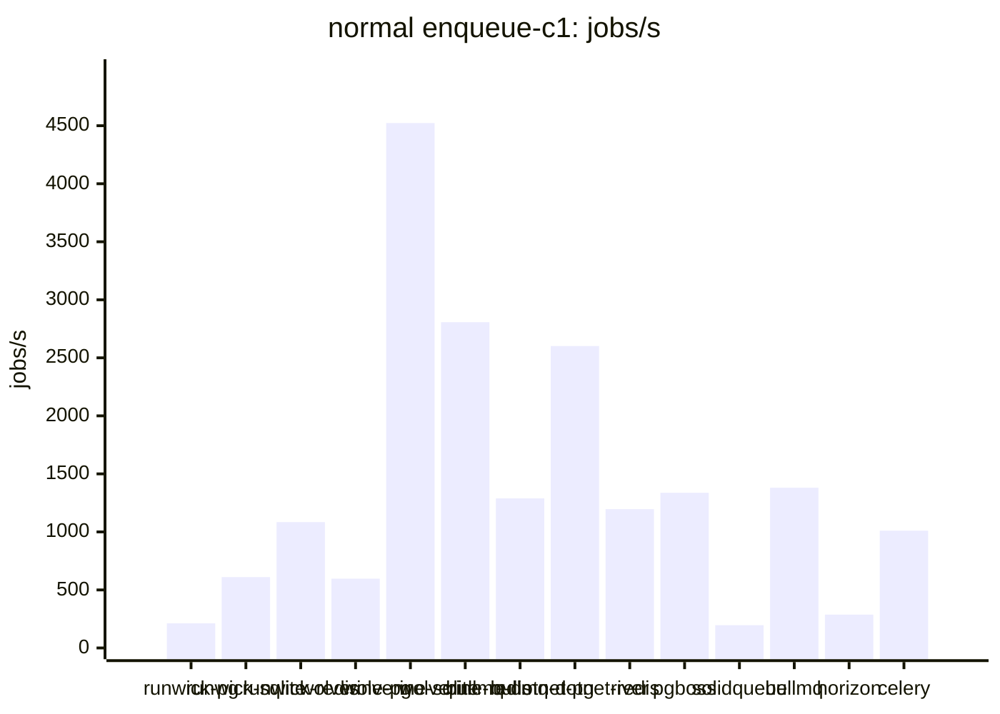
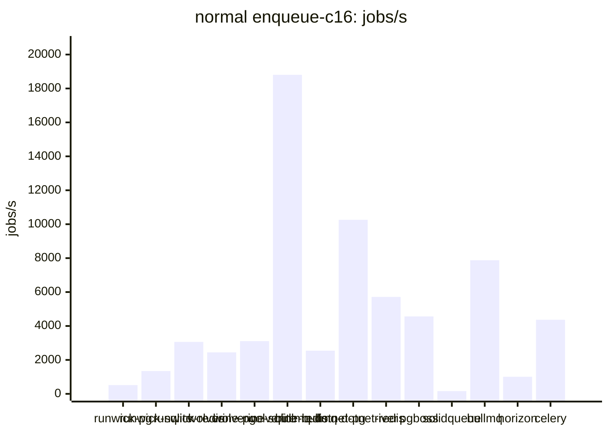
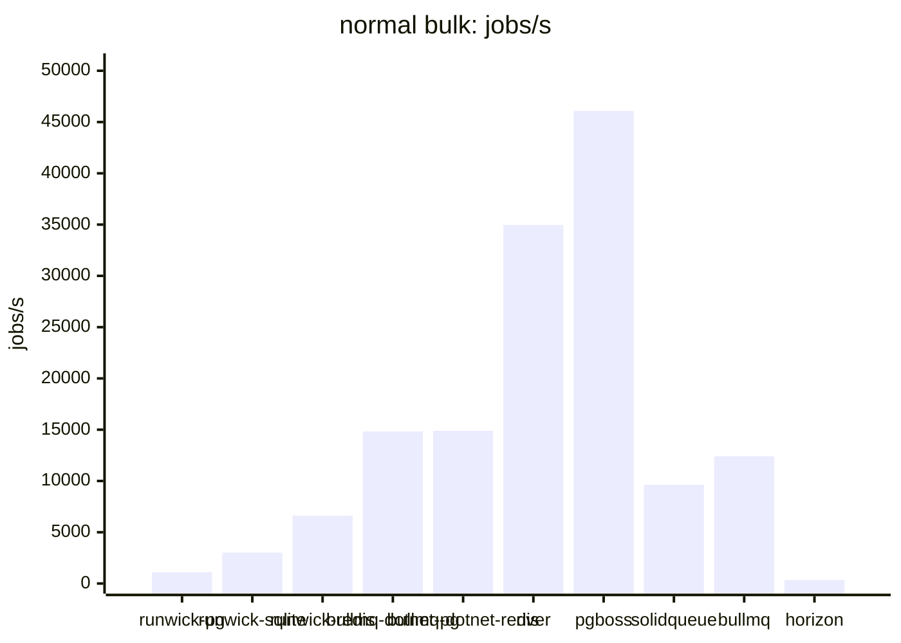
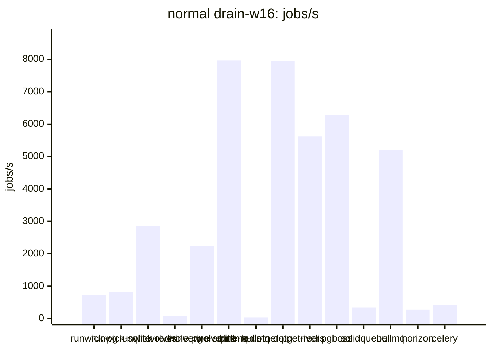
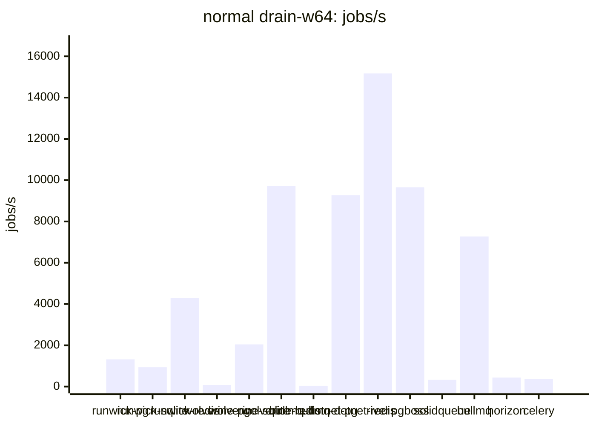
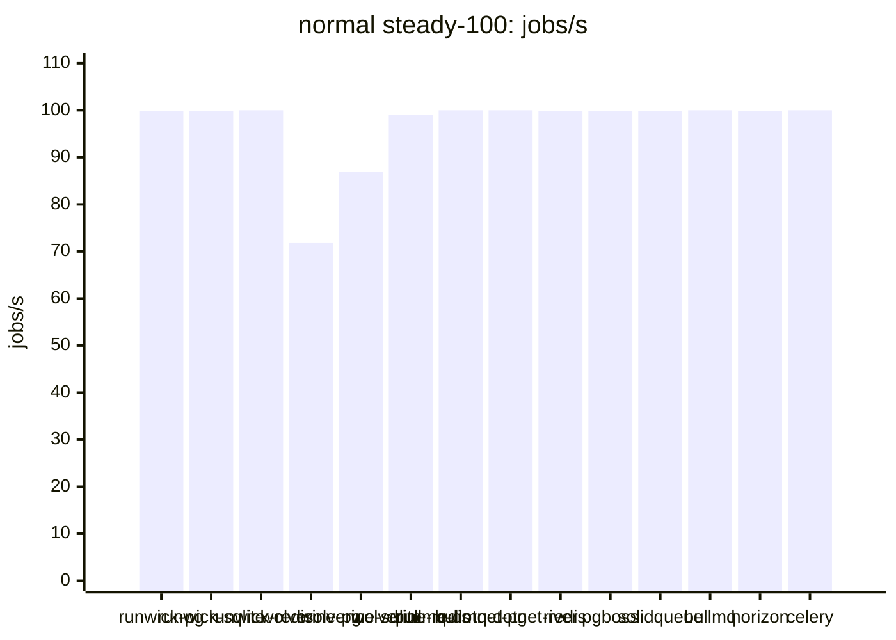
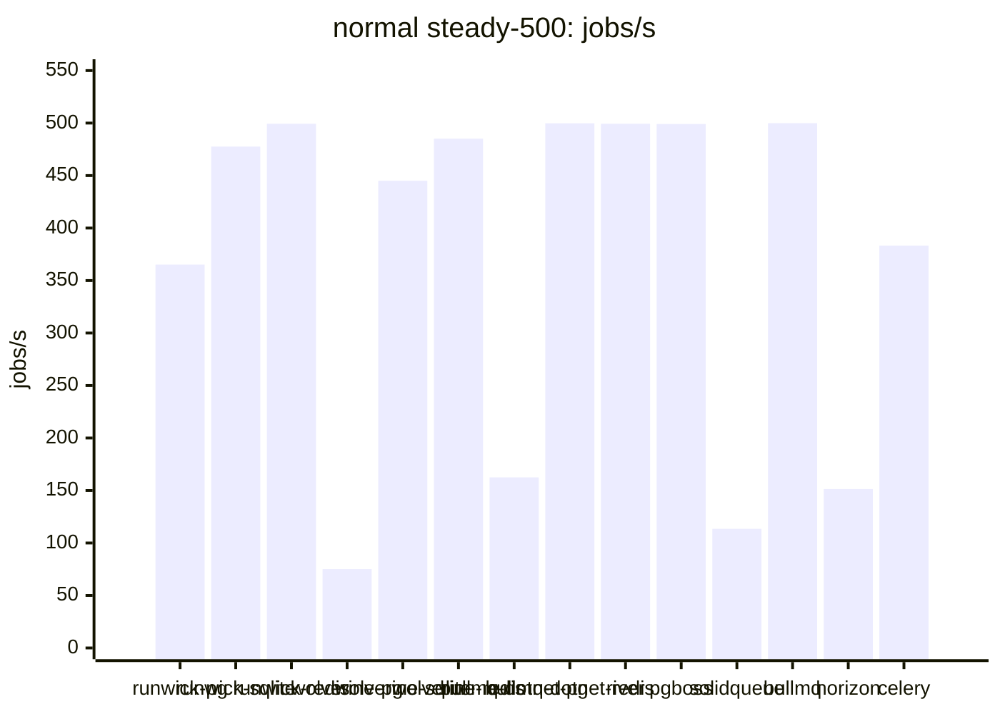
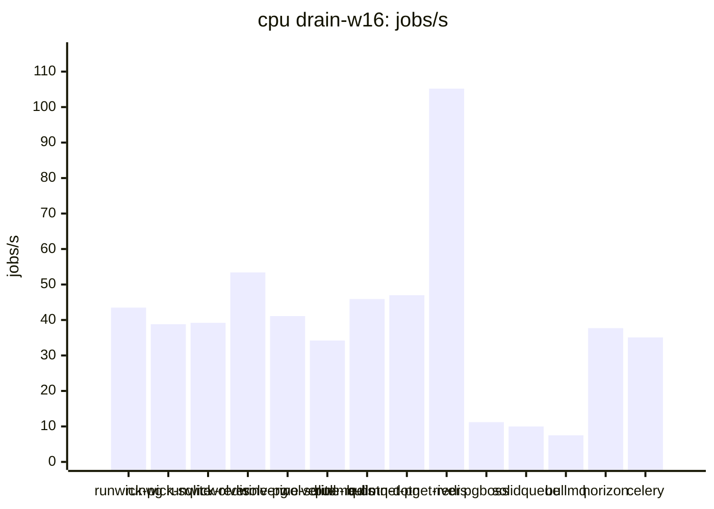
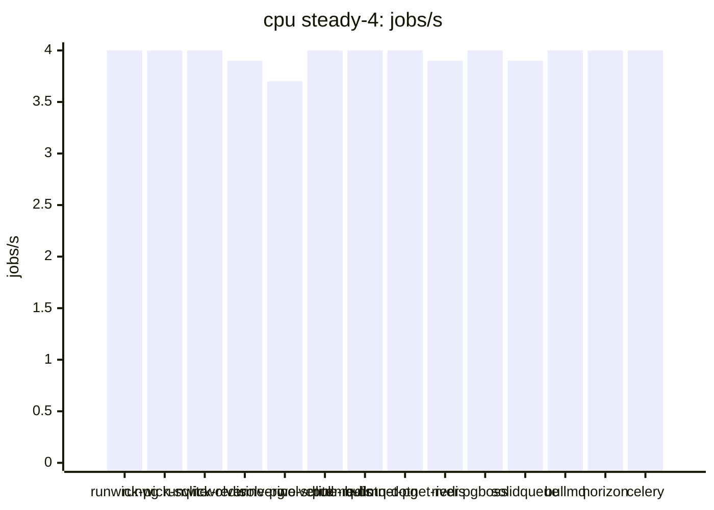

# Queue library benchmark, 2026-11-23 (Runwick 0.1.5)

This report compares Runwick 0.1.5 with 11 other background-job libraries on identical GitHub-hosted machines.
It is written for a reviewer who has not seen the work before: please check the method and the caveats as much as
the numbers, and say where the comparison is unfair to anyone.

- Workflow run: [45273562448](https://github.com/adzamkomladev/runwick/actions/runs/45273562448) (all 28 jobs passed),
  on commit `de189dc`, which is the `v0.1.5` release tag.
- Workflow: `.github/workflows/bench.yml` (manual trigger). Harnesses: `eng/bench-compare/<library>/`.
  Method in detail: [`eng/bench-compare/ci/README.md`](../../eng/bench-compare/ci/README.md).
- Raw data: the run's `bench-<library>-<workload>` artifacts (JSON and logs per round), and `bench-report`.

## How it was measured

- **One machine per library and workload.** Each of the 28 combinations (14 library setups x 2 workloads) ran on its
  own fresh `ubuntu-24.04` runner (4 cores, 16 GB). The library's database ran in a container on the same machine.
- **Stores.** PostgreSQL 18; Redis 8.2 with AOF `appendfsync always` and no snapshots for every Redis library
  (Runwick requires that profile, so everyone got it); SQLite as a local file. Everything else is each library's
  defaults. Every round starts from an empty store.
- **Two workloads.**
  - *normal*: a 1 KiB job that does nothing. Tests: add one job at a time with 1 and 16 callers; add 20,000 with the
    library's bulk call; process a 20,000-job backlog with 16 and 64 worker slots; steady arrivals at 100 and 500
    jobs/s for 30 s.
  - *cpu*: the same job doing 50,000 rounds of SHA-256 (about 0.1–0.5 s of one core). Tests: process a 400-job
    backlog with 16 slots; 4 jobs/s arriving for 60 s.
- **Numbers.** Each test ran 3 times; tables show the median. Besides throughput and latency, a sampler records the
  CPU, memory (PSS) and disk use of every process the test started, and the database container's CPU, memory, disk
  and network bytes. "CPU ms per job" adds app and database CPU time and divides by finished jobs.
- **.NET** contenders run with server GC. **Wolverine** sends to Redis inline (an add counts only once Redis holds it);
  its PostgreSQL and SQLite queues are always durable. **Solid Queue** runs on SQLite (Rails 8's default) with
  `default_transaction_mode: IMMEDIATE` and a 10 s busy timeout, without which 16 concurrent callers fail with
  "database is locked".

## What the numbers say

Read these with the caveats below; differences under about 30% between two libraries are within this setup's noise.

1. **Empty jobs, Redis.** Wolverine (7,965 jobs/s) and BullMQ .NET (7,949) process a backlog fastest, ahead of
   BullMQ for Node (5,197). Runwick Redis does 2,864, about a third of the leaders. Adding jobs one at a time,
   Wolverine on Redis is far ahead (18,805/s with 16 callers); Runwick Redis does 3,063.
2. **Empty jobs, PostgreSQL.** River (5,626 with 16 workers, 15,171 with 64) and pg-boss (6,287 / 9,656) lead by a wide
   margin. Runwick PostgreSQL does 728 / 1,321 and is the slowest PostgreSQL library at adding jobs (518/s with 16
   callers). At a steady 500 jobs/s it fell behind (365/s done, median wait 14.8 s); at 100/s it keeps up (58 ms).
   Wolverine (77/s) and BullMQ .NET (33/s) process a PostgreSQL backlog slowly; both appear to be limited by how
   often they poll, not by the database (their CPU use is low), and we did not tune either.
3. **Empty jobs, SQLite.** Wolverine on SQLite (2,236) processes a backlog about 2.7x faster than Runwick SQLite (826),
   but makes each job wait about 2.9 s at a steady rate; Runwick SQLite keeps up at 500/s with a 93 ms median wait.
   Solid Queue on SQLite does 336.
4. **CPU-heavy jobs.** The work itself is the limit, so most libraries land at 35–53 jobs/s on 4 cores. River is the
   outlier at 105/s (Go hashing is faster and its runtime overhead lowest). Node libraries (BullMQ 7.5, pg-boss 11.2)
   and Solid Queue (10) run job code on one core by default, so they fall far behind; that is their default
   behaviour, not a fault in the harness.
5. **Cost per job.** For empty jobs River, pg-boss, BullMQ (Node and .NET) and Wolverine Redis spend under 0.5 ms of
   CPU per job. Runwick Redis spends 0.89 ms, Runwick SQLite 1.9 ms and Runwick PostgreSQL 5.3 ms. Runwick uses
   89–133 MB of memory; Wolverine 250–390 MB; River 26 MB.

## Caveats

- **Runner CPUs differ, and it matters.** GitHub hands out different CPU models (Xeon 6975P-C, Xeon Platinum
  8573C/8370C, EPYC 7763/9V45/9V74; see "Versions tested"). Between this run and the previous one (run 45248262594,
  same harness), libraries whose code did not change moved by up to 50%: BullMQ for Node's backlog rate fell from
  9,110 to 5,197 and Celery's from 757 to 408, each on a different CPU model. Runwick PostgreSQL's normal workload ran
  on an EPYC 7763 here and a Xeon 6975P-C last time, so its drop since 0.1.4 (enqueue 808 → 518/s) cannot be
  attributed to 0.1.5. Treat single-run differences as indicative only.
- **Steady-rate waits only count finished jobs.** A library that cannot keep up shows a long wait *and* fewer jobs
  done (Runwick PostgreSQL, Wolverine PostgreSQL, BullMQ .NET PostgreSQL, Celery at 500/s). Solid Queue's 19 ms at
  500/s is low because it could only add about 160 jobs/s, so it never saw 500/s of load.
- **Horizon's backlog tests used 2 rounds, not 3.** In round 3 of both backlog tests the harness found most of the
  seeded jobs already gone before timing started (736 and 868 of 20,000 left), most likely because a worker from an
  earlier round was still running. The harness refused those rounds; the bug is in our Horizon harness and is not
  fixed yet.
- **Defaults only.** No library was tuned. Wolverine's and BullMQ .NET's PostgreSQL polling intervals, Celery's
  prefetch and Node's single-threaded job execution are all left as shipped.
- **Bulk add.** Wolverine and Celery have no bulk-add call, so that column is blank for them.
- **Not a production setup.** The database shares 4 cores with the workers, there is no network between them, and
  each test is short (30–60 s steady, or a fixed backlog).

## Questions for the reviewer

1. Is any library set up in a way that is unfair to it (a default we should have changed, a harness that does extra
   work)? The harnesses are short: `eng/bench-compare/<library>/`.
2. Are Wolverine's and BullMQ .NET's PostgreSQL backlog rates (77/s and 33/s) really their defaults, or a harness
   mistake? We could not find a cause in our code.
3. Is one run on mixed CPU models good enough to publish, or should we pin runs to one CPU model (rerun until the
   model matches, or use a larger fixed runner) first?
4. Does the summary above match the full tables below?

## Versions tested

| Library | Version | Runner CPU (normal / cpu) |
|---|---|---|
| Runwick PostgreSQL | `runwick v0.1.5` | EPYC 7763 / Xeon 6975P-C |
| Runwick SQLite | `runwick v0.1.5` | Xeon Plat. 8573C / EPYC 7763 |
| Runwick Redis | `runwick v0.1.5` | Xeon 6975P-C / EPYC 7763 |
| Wolverine (.NET, PG) | `wolverine 6.65.1 (postgres)` | EPYC 7763 / EPYC 9V45 |
| Wolverine (.NET, SQLite) | `wolverine 6.65.1 (sqlite)` | Xeon 6975P-C / Xeon 6975P-C |
| Wolverine (.NET, Redis) | `wolverine 6.65.1 (redis)` | Xeon 6975P-C / EPYC 7763 |
| BullMQ .NET (PG) | `bullmq-dotnet 1.3.7 (postgres)` | EPYC 7763 / Xeon 6975P-C |
| BullMQ .NET (Redis) | `bullmq-dotnet 1.3.7 (redis)` | Xeon 6975P-C / Xeon 6975P-C |
| River (Go, PG) | `river v0.50.0` | Xeon Plat. 8573C / EPYC 9V45 |
| pg-boss (Node, PG) | `pg-boss 12.38.0` | Xeon 6975P-C / EPYC 9V74 |
| Solid Queue (Rails, SQLite) | `solid_queue 1.2.1 (sqlite 3.54.1, rails 8.0.5.2, ruby 3.4.13)` | Xeon 6975P-C / Xeon 6975P-C |
| BullMQ (Node, Redis) | `bullmq 6.7.2` | Xeon Plat. 8573C / Xeon Plat. 8370C |
| Laravel Horizon (PHP, Redis) | `laravel-horizon 5.50.1 (framework 13.43.0, php 8.4.28, phpredis)` | EPYC 9V45 / Xeon 6975P-C |
| Celery (Python, Redis) | `celery 5.5.3 (redis broker, prefork)` | Xeon Plat. 8573C / EPYC 7763 |

## Headline numbers

Medians of 3 rounds. Jobs/s = finished jobs per second unless the column says otherwise. Wait = time from a job being added to a worker finishing it, at a steady arrival rate.

| Library | Process 20k, 16 workers (jobs/s) | Process 20k, 64 workers | Add, 16 callers (jobs/s) | Bulk add 20k (jobs/s) | Steady 500/s: done/s | Steady 500/s: p50 wait ms | CPU-heavy 400 jobs (jobs/s) | CPU ms per empty job | App memory MB |
|---|---:|---:|---:|---:|---:|---:|---:|---:|---:|
| Runwick PostgreSQL | 728 | 1,321 | 518 | 1,106 | 365 | 14,777 | 43.5 | 5.30 | 133 |
| Runwick SQLite | 826 | 935 | 1,344 | 3,016 | 478 | 93 | 38.8 | 1.89 | 94 |
| Runwick Redis | 2,864 | 4,296 | 3,063 | 6,612 | 499 | 20 | 39.2 | 0.89 | 89 |
| Wolverine (.NET, PG) | 77 | 77 | 2,447 | – | 75 | 39,785 | 53.4 | 2.58 | 264 |
| Wolverine (.NET, SQLite) | 2,236 | 2,044 | 3,107 | – | 445 | 2,920 | 41.1 | 0.66 | 393 |
| Wolverine (.NET, Redis) | 7,965 | 9,722 | 18,805 | – | 485 | 496 | 34.2 | 0.49 | 247 |
| BullMQ .NET (PG) | 33 | 33 | 2,543 | 14,834 | 162 | 11,859 | 45.9 | 5.08 | 115 |
| BullMQ .NET (Redis) | 7,949 | 9,272 | 10,259 | 14,897 | 500 | 1 | 47.0 | 0.44 | 83 |
| River (Go, PG) | 5,626 | 15,171 | 5,712 | 34,966 | 499 | 88 | 105.2 | 0.23 | 26 |
| pg-boss (Node, PG) | 6,287 | 9,656 | 4,563 | 46,093 | 499 | 258 | 11.2 | 0.20 | 144 |
| Solid Queue (Rails, SQLite) | 336 | 325 | 160 | 9,626 | 114 | 19 | 10.0 | 6.41 | 478 |
| BullMQ (Node, Redis) | 5,197 | 7,270 | 7,877 | 12,406 | 500 | 3 | 7.5 | 0.35 | 251 |
| Laravel Horizon (PHP, Redis) | 278 | 436 | 1,006 | 355 | 151 | 22 | 37.7 | 9.25 | 772 |
| Celery (Python, Redis) | 408 | 363 | 4,368 | – | 383 | 5,250 | 35.1 | 2.83 | 374 |

A dash means the library has no such API (bulk add) or the test did not produce that number.

## Full results

Generated by `eng/bench-compare/ci/report.py` from the run's artifacts, unedited.

Every library ran on its own fresh GitHub-hosted runner (ubuntu-24.04), against its own PostgreSQL 18 or Redis 8.2 (AOF, appendfsync always) container, or a local SQLite file. **normal** = a 1 KiB no-op job; **cpu** = the same job doing 50,000 SHA-256 rounds over 1 KiB (≈0.1–0.5 s of one core, depending on the language). Cells are medians over rounds. *App* = every process the benchmark started (producers + workers + driver); *Store* = the database container. *CPU ms/job* = app + store CPU time per finished job. *Wire B/job* = bytes in and out of the store container per job. Runners can differ in CPU model: see Hosts.

### normal · enqueue-c1

Push one job at a time, 1 caller (jobs added/s, add latency)

| Library | Jobs/s | p50 ms | p99 ms | App CPU % | App mem MB | Store CPU % | CPU ms/job | Wire B/job | Disk write B/job |
|---|---:|---:|---:|---:|---:|---:|---:|---:|---:|
| Runwick PostgreSQL | 212 | 4.3 | 8.0 | 61.7 | 71.4 | 69.9 | 7.1 | 4,405 | 16,556 |
| Runwick SQLite | 610 | 1.5 | 4.0 | 104 | 54.1 | – | 1.9 | – | 120,295 |
| Runwick Redis | 1,084 | 0.87 | 1.3 | 76.4 | 59.4 | 38.8 | 1.4 | 2,725 | 15,499 |
| Wolverine (.NET, PG) | 597 | 1.6 | 3.0 | 130 | 103 | 38.7 | 3.9 | 3,448 | 22,192 |
| Wolverine (.NET, SQLite) | 4,523 | 0.18 | 1.0 | 137 | 63.0 | – | 0.65 | – | 5,620 |
| Wolverine (.NET, Redis) | 2,807 | 0.33 | 0.53 | 58.8 | 69.9 | 5.5 | 0.82 | 1,975 | 11,735 |
| BullMQ .NET (PG) | 1,289 | 0.70 | 1.6 | 72.3 | 63.3 | 41.3 | 1.2 | 1,928 | 12,878 |
| BullMQ .NET (Redis) | 2,602 | 0.36 | 0.52 | 94.0 | 41.0 | 23.7 | 0.55 | 1,605 | 11,457 |
| River (Go, PG) | 1,196 | 0.81 | 1.1 | 29.9 | 16.2 | 43.3 | 0.64 | 3,320 | 12,579 |
| pg-boss (Node, PG) | 1,337 | 0.76 | 1.1 | 26.8 | 75.6 | 69.4 | 0.81 | 4,648 | 25,231 |
| Solid Queue (Rails, SQLite) | 196 | 5.2 | 8.4 | 99.7 | 124 | – | 5.5 | – | 60,862 |
| BullMQ (Node, Redis) | 1,380 | 0.68 | 1.3 | 36.5 | 87.5 | 24.3 | 0.49 | 1,579 | 5,720 |
| Laravel Horizon (PHP, Redis) | 287 | 2.5 | 14.8 | 23.5 | 64.4 | 8.9 | 1.6 | 4,733 | 19,337 |
| Celery (Python, Redis) | 1,010 | 0.98 | 1.4 | 33.1 | 41.7 | 7.2 | 0.74 | 3,493 | 7,823 |

### normal · enqueue-c16

Push one job at a time, 16 concurrent callers

| Library | Jobs/s | p50 ms | p99 ms | App CPU % | App mem MB | Store CPU % | CPU ms/job | Wire B/job | Disk write B/job |
|---|---:|---:|---:|---:|---:|---:|---:|---:|---:|
| Runwick PostgreSQL | 518 | 29.2 | 62.6 | 77.9 | 88.2 | 257 | 7.2 | 3,631 | 9,928 |
| Runwick SQLite | 1,344 | 10.8 | 21.0 | 132 | 61.0 | – | 1.1 | – | 54,199 |
| Runwick Redis | 3,063 | 4.9 | 7.7 | 123 | 64.3 | 83.3 | 0.74 | 2,557 | 8,679 |
| Wolverine (.NET, PG) | 2,447 | 6.2 | 11.4 | 147 | 110 | 104 | 1.3 | 2,591 | 8,937 |
| Wolverine (.NET, SQLite) | 3,107 | 3.4 | 32.8 | 85.9 | 84.2 | – | 0.32 | – | 46,203 |
| Wolverine (.NET, Redis) | 18,805 | 0.76 | 2.2 | 54.6 | 101 | 6.9 | 0.23 | 1,827 | 4,928 |
| BullMQ .NET (PG) | 2,543 | 5.5 | 9.9 | 118 | 73.2 | 137 | 1.1 | 1,815 | 10,795 |
| BullMQ .NET (Redis) | 10,259 | 1.5 | 2.9 | 124 | 75.2 | 46.6 | 0.19 | 1,475 | 4,461 |
| River (Go, PG) | 5,712 | 2.6 | 5.4 | 85.8 | 17.7 | 192 | 0.51 | 3,315 | 5,108 |
| pg-boss (Node, PG) | 4,563 | 3.3 | 7.3 | 47.4 | 90.1 | 274 | 0.76 | 4,625 | 9,937 |
| Solid Queue (Rails, SQLite) | 160 | 13.7 | 741 | 104 | 200 | – | 6.6 | – | 65,885 |
| BullMQ (Node, Redis) | 7,877 | 1.9 | 3.4 | 67.4 | 109 | 54.3 | 0.17 | 1,507 | 2,139 |
| Laravel Horizon (PHP, Redis) | 1,006 | 12.3 | 67.0 | 158 | 688 | 18.9 | 2.3 | 4,736 | 6,688 |
| Celery (Python, Redis) | 4,368 | 3.3 | 7.8 | 230 | 320 | 13.5 | 0.97 | 3,498 | 4,387 |

### normal · bulk

Push 20,000 jobs with the library's bulk API

| Library | Jobs/s | App CPU % | App mem MB | Store CPU % | CPU ms/job | Wire B/job | Disk write B/job |
|---|---:|---:|---:|---:|---:|---:|---:|
| Runwick PostgreSQL | 1,106 | 27.6 | 90.1 | 89.9 | 1.1 | 1,748 | 3,987 |
| Runwick SQLite | 3,016 | 107 | 68.3 | – | 0.37 | – | 15,361 |
| Runwick Redis | 6,612 | 70.5 | 65.9 | 55.2 | 0.21 | 1,889 | 6,411 |
| BullMQ .NET (PG) | 14,834 | 68.3 | 101 | 55.2 | 0.12 | 1,389 | 2,290 |
| BullMQ .NET (Redis) | 14,897 | 150 | 82.5 | 63.6 | 0.16 | 1,532 | 3,641 |
| River (Go, PG) | 34,966 | 53.0 | 30.0 | 72.3 | 0.04 | 2,317 | 2,054 |
| pg-boss (Node, PG) | 46,093 | 34.8 | 77.5 | 74.3 | 0.03 | 1,061 | 3,795 |
| Solid Queue (Rails, SQLite) | 9,626 | 99.5 | 125 | – | 0.14 | – | 6,439 |
| BullMQ (Node, Redis) | 12,406 | 59.8 | 194 | 60.0 | 0.11 | 1,430 | 1,770 |
| Laravel Horizon (PHP, Redis) | 355 | 30.9 | 67.8 | 11.2 | 1.3 | 4,556 | 8,609 |

### normal · drain-w16

Process a ready backlog with 16 worker slots (jobs finished/s)

| Library | Jobs/s | Done % | App CPU % | App mem MB | Store CPU % | Store mem MB | CPU ms/job | Wire B/job | Disk write B/job |
|---|---:|---:|---:|---:|---:|---:|---:|---:|---:|
| Runwick PostgreSQL | 728 | 100 | 51.6 | 133 | 209 | 707 | 5.3 | 5,514 | 20,107 |
| Runwick SQLite | 826 | 100 | 119 | 94.3 | – | – | 1.9 | – | 56,302 |
| Runwick Redis | 2,864 | 100 | 100 | 89.1 | 71.4 | 165 | 0.89 | 5,759 | 17,748 |
| Wolverine (.NET, PG) | 76.9 | 100 | 10.7 | 264 | 8.4 | 422 | 2.6 | 4,435 | 19,295 |
| Wolverine (.NET, SQLite) | 2,236 | 100 | 90.3 | 393 | – | – | 0.66 | – | 59,136 |
| Wolverine (.NET, Redis) | 7,965 | 100 | 116 | 247 | 14.2 | 97.6 | 0.49 | 3,708 | 8,141 |
| BullMQ .NET (PG) | 33.3 | 99.9 | 5.2 | 115 | 11.8 | 494 | 5.1 | 4,847 | 18,172 |
| BullMQ .NET (Redis) | 7,949 | 100 | 143 | 82.7 | 71.8 | 98.2 | 0.44 | 3,586 | 7,331 |
| River (Go, PG) | 5,626 | 100 | 47.3 | 26.4 | 64.9 | 363 | 0.23 | 3,789 | 7,803 |
| pg-boss (Node, PG) | 6,287 | 100 | 29.5 | 144 | 76.4 | 358 | 0.20 | 2,820 | 11,833 |
| Solid Queue (Rails, SQLite) | 336 | 100 | 204 | 478 | – | – | 6.4 | – | 83,932 |
| BullMQ (Node, Redis) | 5,197 | 100 | 55.7 | 251 | 69.1 | 96.5 | 0.35 | 3,501 | 3,517 |
| Laravel Horizon (PHP, Redis) | 278 | 100 | 114 | 772 | 24.2 | 157 | 9.2 | 17,066 | 24,002 |
| Celery (Python, Redis) | 408 | 100 | 81.1 | 374 | 16.2 | 126 | 2.8 | 11,295 | 23,590 |

### normal · drain-w64

Process a ready backlog with 64 worker slots

| Library | Jobs/s | Done % | App CPU % | App mem MB | Store CPU % | Store mem MB | CPU ms/job | Wire B/job | Disk write B/job |
|---|---:|---:|---:|---:|---:|---:|---:|---:|---:|
| Runwick PostgreSQL | 1,321 | 100 | 56.8 | 131 | 260 | 716 | 4.8 | 5,350 | 13,509 |
| Runwick SQLite | 935 | 100 | 119 | 103 | – | – | 1.7 | – | 41,685 |
| Runwick Redis | 4,296 | 100 | 90.8 | 97.3 | 75.4 | 167 | 0.68 | 5,551 | 14,805 |
| Wolverine (.NET, PG) | 77.0 | 100 | 10.3 | 256 | 8.3 | 464 | 2.5 | 4,429 | 17,230 |
| Wolverine (.NET, SQLite) | 2,044 | 100 | 87.1 | 388 | – | – | 0.66 | – | 58,976 |
| Wolverine (.NET, Redis) | 9,722 | 100 | 88.6 | 263 | 9.8 | 94.1 | 0.45 | 3,685 | 6,451 |
| BullMQ .NET (PG) | 33.2 | 99.7 | 5.3 | 133 | 12.9 | 714 | 5.5 | 4,944 | 16,746 |
| BullMQ .NET (Redis) | 9,272 | 100 | 142 | 83.5 | 73.2 | 98.2 | 0.39 | 3,554 | 6,420 |
| River (Go, PG) | 15,171 | 100 | 78.7 | 27.4 | 104 | 371 | 0.17 | 3,754 | 6,238 |
| pg-boss (Node, PG) | 9,656 | 100 | 31.7 | 150 | 78.8 | 362 | 0.15 | 2,641 | 10,516 |
| Solid Queue (Rails, SQLite) | 325 | 100 | 222 | 572 | – | – | 7.2 | – | 70,927 |
| BullMQ (Node, Redis) | 7,270 | 100 | 64.7 | 244 | 77.0 | 96.2 | 0.32 | 3,483 | 3,082 |
| Laravel Horizon (PHP, Redis) | 436 | 100 | 78.1 | 2,733 | 21.4 | 151 | 5.5 | 17,274 | 24,661 |
| Celery (Python, Redis) | 363 | 100 | 89.0 | 1,341 | 16.6 | 139 | 3.4 | 11,297 | 25,190 |

### normal · steady-100

100 jobs/s arriving for 30 s: finished/s and enqueue-to-finished latency

| Library | Jobs/s | p50 ms | p99 ms | Done % | App CPU % | App mem MB | Store CPU % | Store mem MB | CPU ms/job | Wire B/job |
|---|---:|---:|---:|---:|---:|---:|---:|---:|---:|---:|
| Runwick PostgreSQL | 99.8 | 57.9 | 260 | 100 | 60.4 | 111 | 90.8 | 677 | 16.0 | 9,672 |
| Runwick SQLite | 99.8 | 54.3 | 86.0 | 100 | 60.2 | 79.8 | – | – | 6.1 | – |
| Runwick Redis | 100 | 26.8 | 51.3 | 100 | 21.5 | 85.7 | 8.7 | 138 | 3.1 | 7,578 |
| Wolverine (.NET, PG) | 71.9 | 7,563 | 11,490 | 100 | 23.6 | 263 | 7.6 | 382 | 5.1 | 5,351 |
| Wolverine (.NET, SQLite) | 86.9 | 2,558 | 4,997 | 100 | 11.6 | 262 | – | – | 1.6 | – |
| Wolverine (.NET, Redis) | 99.1 | 488 | 986 | 100 | 14.1 | 237 | 1.7 | 82.0 | 1.9 | 3,958 |
| BullMQ .NET (PG) | 100 | 5.0 | 8.0 | 100 | 43.6 | 79.5 | 52.5 | 380 | 10.0 | 13,720 |
| BullMQ .NET (Redis) | 100 | 2.0 | 3.0 | 100 | 19.0 | 59.8 | 6.6 | 65.6 | 2.6 | 6,032 |
| River (Go, PG) | 99.9 | 132 | 252 | 100 | 11.0 | 17.2 | 11.5 | 368 | 2.3 | 6,801 |
| pg-boss (Node, PG) | 99.8 | 253 | 500 | 100 | 4.0 | 86.6 | 7.1 | 341 | 1.1 | 6,255 |
| Solid Queue (Rails, SQLite) | 99.9 | 17.0 | 97.0 | 100 | 129 | 483 | – | – | 13.7 | – |
| BullMQ (Node, Redis) | 100 | 3.0 | 5.0 | 100 | 10.1 | 130 | 9.8 | 64.8 | 2.0 | 6,033 |
| Laravel Horizon (PHP, Redis) | 99.9 | 12.4 | 254 | 100 | 26.7 | 786 | 10.6 | 79.7 | 7.1 | 19,766 |
| Celery (Python, Redis) | 100 | 2.7 | 3.2 | 100 | 26.5 | 378 | 6.0 | 69.0 | 3.5 | 11,494 |

### normal · steady-500

500 jobs/s arriving for 30 s

| Library | Jobs/s | p50 ms | p99 ms | Done % | App CPU % | App mem MB | Store CPU % | Store mem MB | CPU ms/job | Wire B/job |
|---|---:|---:|---:|---:|---:|---:|---:|---:|---:|---:|
| Runwick PostgreSQL | 365 | 14,777 | 19,094 | 100 | 78.1 | 133 | 239 | 790 | 9.1 | 6,977 |
| Runwick SQLite | 478 | 92.9 | 329 | 100 | 134 | 92.4 | – | – | 2.9 | – |
| Runwick Redis | 499 | 20.4 | 47.0 | 100 | 51.8 | 94.7 | 34.5 | 152 | 1.8 | 6,932 |
| Wolverine (.NET, PG) | 75.1 | 39,785 | 75,770 | 45.1 | 33.6 | 266 | 15.0 | 422 | 7.0 | 9,373 |
| Wolverine (.NET, SQLite) | 445 | 2,920 | 5,314 | 100 | 28.6 | 307 | – | – | 0.77 | – |
| Wolverine (.NET, Redis) | 485 | 496 | 991 | 100 | 29.1 | 247 | 4.5 | 72.3 | 0.78 | 3,888 |
| BullMQ .NET (PG) | 162 | 11,859 | 47,168 | 98.9 | 27.8 | 106 | 101 | 476 | 8.0 | 7,067 |
| BullMQ .NET (Redis) | 500 | 1.0 | 2.0 | 100 | 70.6 | 74.1 | 25.1 | 72.9 | 2.0 | 5,846 |
| River (Go, PG) | 499 | 87.9 | 237 | 100 | 37.4 | 18.0 | 45.4 | 370 | 1.7 | 6,749 |
| pg-boss (Node, PG) | 499 | 258 | 503 | 100 | 8.7 | 142 | 30.3 | 327 | 0.79 | 6,167 |
| Solid Queue (Rails, SQLite) | 114 | 19.0 | 100.0 | 100 | 144 | 479 | – | – | 13.5 | – |
| BullMQ (Node, Redis) | 500 | 3.0 | 6.0 | 100 | 25.5 | 140 | 32.9 | 73.4 | 1.2 | 5,053 |
| Laravel Horizon (PHP, Redis) | 151 | 21.6 | 234 | 100 | 32.9 | 786 | 12.1 | 64.3 | 5.2 | 18,907 |
| Celery (Python, Redis) | 383 | 5,250 | 9,075 | 100 | 88.5 | 380 | 19.1 | 79.6 | 3.0 | 11,501 |

### cpu · drain-w16

Process a ready backlog with 16 worker slots (jobs finished/s)

| Library | Jobs/s | Done % | App CPU % | App mem MB | Store CPU % | Store mem MB | CPU ms/job | Wire B/job | Disk write B/job |
|---|---:|---:|---:|---:|---:|---:|---:|---:|---:|
| Runwick PostgreSQL | 43.5 | 100 | 347 | 88.5 | 17.8 | 188 | 93.5 | 11,326 | 73,687 |
| Runwick SQLite | 38.8 | 100 | 372 | 81.8 | – | – | 103 | – | 79,596 |
| Runwick Redis | 39.2 | 100 | 368 | 79.5 | 3.1 | 22.8 | 102 | 6,356 | 7,977 |
| Wolverine (.NET, PG) | 53.4 | 100 | 316 | 218 | 8.8 | 121 | 67.6 | 6,046 | 28,631 |
| Wolverine (.NET, SQLite) | 41.1 | 100 | 348 | 214 | – | – | 89.2 | – | 56,412 |
| Wolverine (.NET, Redis) | 34.2 | 100 | 236 | 214 | 0.90 | 8.6 | 107 | 3,917 | 6,851 |
| BullMQ .NET (PG) | 45.9 | 100 | 370 | 65.9 | 9.0 | 171 | 85.9 | 5,736 | 56,812 |
| BullMQ .NET (Redis) | 47.0 | 100 | 381 | 59.3 | 1.7 | 9.8 | 83.8 | 8,387 | 13,189 |
| River (Go, PG) | 105 | 100 | 358 | 16.2 | 4.1 | 114 | 35.8 | 4,041 | 21,176 |
| pg-boss (Node, PG) | 11.2 | 100 | 108 | 102 | 0.70 | 119 | 98.4 | 3,127 | 30,720 |
| Solid Queue (Rails, SQLite) | 10.0 | 100 | 366 | 453 | – | – | 375 | – | 80,906 |
| BullMQ (Node, Redis) | 7.5 | 100 | 109 | 141 | 0.70 | 10.3 | 148 | 3,916 | 5,366 |
| Laravel Horizon (PHP, Redis) | 37.7 | 100 | 146 | 772 | 2.0 | 19.9 | 84.3 | 18,048 | 70,799 |
| Celery (Python, Redis) | 35.1 | 100 | 296 | 393 | 2.1 | 14.5 | 109 | 11,731 | 24,566 |

### cpu · steady-4

4 CPU-heavy jobs/s arriving for 60 s: finished/s and enqueue-to-finished latency

| Library | Jobs/s | p50 ms | p99 ms | Done % | App CPU % | App mem MB | Store CPU % | Store mem MB | CPU ms/job | Wire B/job |
|---|---:|---:|---:|---:|---:|---:|---:|---:|---:|---:|
| Runwick PostgreSQL | 4.0 | 103 | 136 | 100 | 29.0 | 95.7 | 6.7 | 153 | 90.6 | 24,531 |
| Runwick SQLite | 4.0 | 114 | 147 | 100 | 38.4 | 74.6 | – | – | 96.8 | – |
| Runwick Redis | 4.0 | 69.3 | 91.4 | 100 | 35.3 | 82.3 | 1.7 | 23.4 | 93.4 | 13,786 |
| Wolverine (.NET, PG) | 3.9 | 2,709 | 5,194 | 100 | 24.8 | 225 | 0.90 | 123 | 73.6 | 7,472 |
| Wolverine (.NET, SQLite) | 3.7 | 2,776 | 5,123 | 100 | 32.1 | 225 | – | – | 94.2 | – |
| Wolverine (.NET, Redis) | 4.0 | 413 | 885 | 100 | 31.5 | 212 | 0.70 | 8.8 | 89.8 | 5,657 |
| BullMQ .NET (PG) | 4.0 | 51.0 | 61.0 | 100 | 22.4 | 62.5 | 2.0 | 124 | 61.8 | 15,267 |
| BullMQ .NET (Redis) | 4.0 | 50.0 | 54.0 | 100 | 21.8 | 54.8 | 0.80 | 10.5 | 57.2 | 7,147 |
| River (Go, PG) | 3.9 | 44.8 | 47.1 | 100 | 11.7 | 17.0 | 0.70 | 117 | 31.8 | 8,005 |
| pg-boss (Node, PG) | 4.0 | 430 | 768 | 100 | 40.3 | 103 | 1.1 | 118 | 104 | 9,013 |
| Solid Queue (Rails, SQLite) | 3.9 | 224 | 387 | 100 | 89.8 | 440 | – | – | 236 | – |
| BullMQ (Node, Redis) | 4.0 | 136 | 150 | 100 | 58.7 | 140 | 0.90 | 10.6 | 151 | 7,068 |
| Laravel Horizon (PHP, Redis) | 4.0 | 54.0 | 59.0 | 100 | 21.0 | 814 | 0.80 | 20.0 | 75.8 | 20,878 |
| Celery (Python, Redis) | 4.0 | 69.2 | 74.8 | 100 | 28.6 | 378 | 0.70 | 14.9 | 76.2 | 11,952 |

**Not applicable:** celery bulk, wolverine-pg bulk, wolverine-redis bulk, wolverine-sqlite bulk (no bulk-enqueue API).

**Failed runs** (see that job's artifact logs): horizon/normal/drain-w16, horizon/normal/drain-w64

### Versions and hosts

| Run | Library version | CPU | Cores | RAM MB | Commit |
|---|---|---|---:|---:|---|
| bullmq--cpu | bullmq 6.7.2 | Intel(R) Xeon(R) Platinum 8370C CPU @ 2.80GHz | 4 | 15,982 | de189dc |
| bullmq--normal | bullmq 6.7.2 | INTEL(R) XEON(R) PLATINUM 8573C | 4 | 15,982 | de189dc |
| bullmq-dotnet-pg--cpu | bullmq-dotnet 1.3.7 (postgres) | Intel(R) Xeon(R) 6975P-C | 4 | 15,701 | de189dc |
| bullmq-dotnet-pg--normal | bullmq-dotnet 1.3.7 (postgres) | AMD EPYC 7763 64-Core Processor | 4 | 15,983 | de189dc |
| bullmq-dotnet-redis--cpu | bullmq-dotnet 1.3.7 (redis) | Intel(R) Xeon(R) 6975P-C | 4 | 15,701 | de189dc |
| bullmq-dotnet-redis--normal | bullmq-dotnet 1.3.7 (redis) | Intel(R) Xeon(R) 6975P-C | 4 | 15,701 | de189dc |
| celery--cpu | celery 5.5.3 (redis broker, prefork) | AMD EPYC 7763 64-Core Processor | 4 | 15,983 | de189dc |
| celery--normal | celery 5.5.3 (redis broker, prefork) | INTEL(R) XEON(R) PLATINUM 8573C | 4 | 15,982 | de189dc |
| horizon--cpu | laravel-horizon 5.50.1 (framework 13.43.0, php 8.4.28, phpredis) | Intel(R) Xeon(R) 6975P-C | 4 | 15,701 | de189dc |
| horizon--normal | laravel-horizon 5.50.1 (framework 13.43.0, php 8.4.28, phpredis) | AMD EPYC 9V45 96-Core Processor | 4 | 15,983 | de189dc |
| pgboss--cpu | pg-boss 12.38.0 | AMD EPYC 9V74 80-Core Processor | 4 | 15,983 | de189dc |
| pgboss--normal | pg-boss 12.38.0 | Intel(R) Xeon(R) 6975P-C | 4 | 15,701 | de189dc |
| river--cpu | river v0.50.0 | AMD EPYC 9V45 96-Core Processor | 4 | 15,983 | de189dc |
| river--normal | river v0.50.0 | INTEL(R) XEON(R) PLATINUM 8573C | 4 | 15,982 | de189dc |
| runwick-pg--cpu | runwick v0.1.5 | Intel(R) Xeon(R) 6975P-C | 4 | 15,701 | de189dc |
| runwick-pg--normal | runwick v0.1.5 | AMD EPYC 7763 64-Core Processor | 4 | 15,983 | de189dc |
| runwick-redis--cpu | runwick v0.1.5 | AMD EPYC 7763 64-Core Processor | 4 | 15,983 | de189dc |
| runwick-redis--normal | runwick v0.1.5 | Intel(R) Xeon(R) 6975P-C | 4 | 15,701 | de189dc |
| runwick-sqlite--cpu | runwick v0.1.5 | AMD EPYC 7763 64-Core Processor | 4 | 15,983 | de189dc |
| runwick-sqlite--normal | runwick v0.1.5 | INTEL(R) XEON(R) PLATINUM 8573C | 4 | 15,982 | de189dc |
| solidqueue--cpu | solid_queue 1.2.1 (sqlite 3.54.1, rails 8.0.5.2, ruby 3.4.13) | Intel(R) Xeon(R) 6975P-C | 4 | 15,701 | de189dc |
| solidqueue--normal | solid_queue 1.2.1 (sqlite 3.54.1, rails 8.0.5.2, ruby 3.4.13) | Intel(R) Xeon(R) 6975P-C | 4 | 15,701 | de189dc |
| wolverine-pg--cpu | wolverine 6.65.1 (postgres) | AMD EPYC 9V45 96-Core Processor | 4 | 15,983 | de189dc |
| wolverine-pg--normal | wolverine 6.65.1 (postgres) | AMD EPYC 7763 64-Core Processor | 4 | 15,983 | de189dc |
| wolverine-redis--cpu | wolverine 6.65.1 (redis) | AMD EPYC 7763 64-Core Processor | 4 | 15,983 | de189dc |
| wolverine-redis--normal | wolverine 6.65.1 (redis) | Intel(R) Xeon(R) 6975P-C | 4 | 15,701 | de189dc |
| wolverine-sqlite--cpu | wolverine 6.65.1 (sqlite) | Intel(R) Xeon(R) 6975P-C | 4 | 15,701 | de189dc |
| wolverine-sqlite--normal | wolverine 6.65.1 (sqlite) | Intel(R) Xeon(R) 6975P-C | 4 | 15,701 | de189dc |
