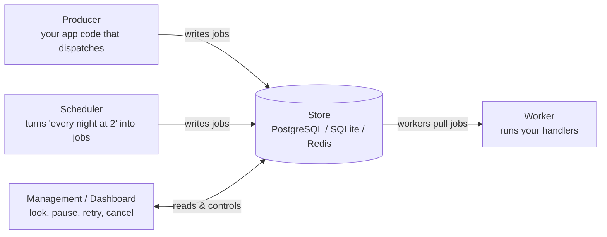
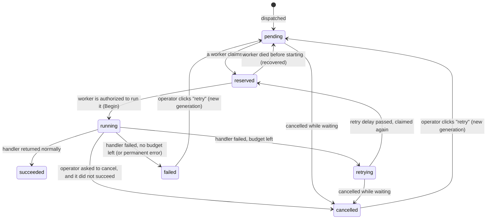
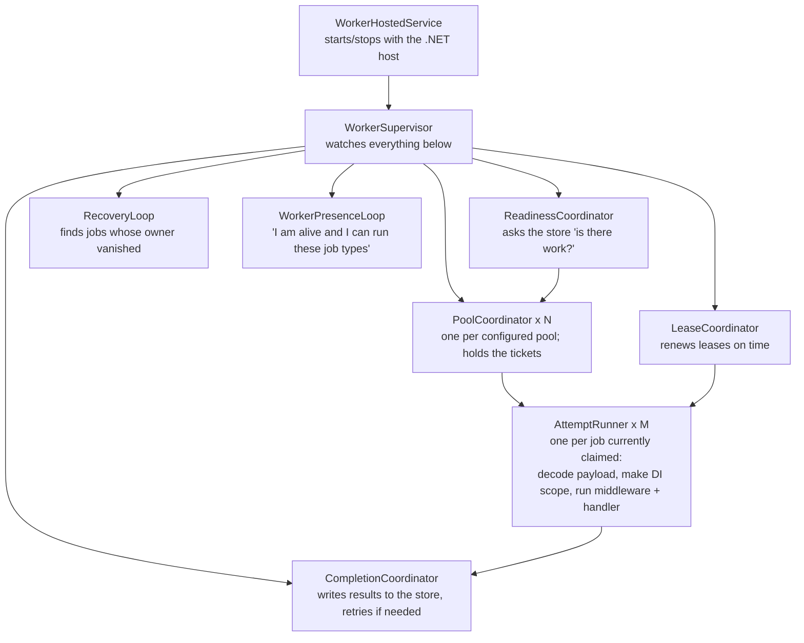

# Spindle, explained from the ground up

This is the friendly tour. It assumes you know C# and have used a database, and nothing else. Every technical word is explained the first time it appears, and there is a glossary at the end if you forget one. The formal design lives in the other documents under `docs/`; this one tells you *what* they decided and *why*, in plain language, so that when you open them they make sense.

Read it top to bottom once. Later, jump to the section you need.

---

## 1. The problem a job queue solves

Imagine a web app. A user clicks "Sign up". Your code must:

1. Save the user to the database.
2. Send a welcome email.
3. Resize their profile picture.
4. Tell the analytics system.

Steps 2–4 are slow, can fail, and the user doesn't need to wait for them. So instead of doing them *inside* the web request, you write a note — "send welcome email to user 42" — and put it somewhere safe. Later, some other code picks the note up and does the work. If the email provider is down, the note stays there and gets picked up again later.

That "somewhere safe" is a **job queue**. The note is a **job**. The code that does the work is a **handler**. The process that picks notes up and runs handlers is a **worker**. Writing the note is called **dispatching** (or enqueueing) the job.

Spindle is a library that gives you all of that for .NET, using a database you already have (PostgreSQL, SQLite, or Redis) as the safe place.

The hard part is not writing notes. The hard part is everything that goes wrong: the worker crashes halfway through, the network drops a reply, two workers grab the same note, someone dispatches the same job twice, the clock on one machine is wrong, and so on. Most of Spindle's design — and most of this document — is about handling those cases without ever lying to you about what happened.

---

## 2. The cast of characters



- **Producer** — any code that calls `DispatchAsync`. Usually your web app.
- **Store** — the database. It is the single source of truth. Workers don't talk to each other; they talk to the store.
- **Worker** — a process (or part of one) that reserves jobs from the store and runs your handler code.
- **Scheduler** — an optional role that creates jobs on a timetable ("every Monday at 09:00").
- **Management / Dashboard** — an optional web UI and API for operators.

These are *roles*, not separate programs. You turn each on with configuration. That gives the five deployment shapes the plan promises:

| Shape | What runs where |
|---|---|
| 1. One app, embedded workers | Your web app is producer + worker in one process |
| 2. One app, external worker | Web app is producer only; a separate console app is the worker |
| 3. Many app replicas, embedded workers | Each replica both dispatches and works |
| 4. App replicas + many external workers | Web tier only dispatches; a worker tier only works |
| 5. Mixed | Some replicas embed workers, extra external workers too |

The job classes and handlers are identical in all five. Only the `AddSpindle(...)` configuration changes.

---

## 3. What you write as a user

A job is a plain data class. A handler is a class that knows what to do with it.

```csharp
[JobName("email.welcome")]      // the durable name of this kind of job (explained in §6.9)
[Queue("emails")]               // which queue it goes into
[Priority("medium")]            // low / medium / high
[MaxExecutions(3)]              // run it at most 3 times before giving up
public sealed record SendWelcomeEmail(Guid UserId, string Locale) : IQueueJob;

public sealed class SendWelcomeEmailHandler(IEmailSender emails)
    : IJobHandler<SendWelcomeEmail>
{
    public Task HandleAsync(SendWelcomeEmail job, CancellationToken ct) =>
        emails.SendWelcomeAsync(job.UserId, job.Locale, ct);
}
```

You register Spindle at startup:

```csharp
builder.Services.AddSpindle(spindle =>
{
    spindle.Application("customer-service");          // a namespace so apps can share a DB
    spindle.UsePostgres(connectionString);

    spindle.AddJobsFromAssemblyContaining<SendWelcomeEmail>();
    spindle.AddHandlersFromAssemblyContaining<SendWelcomeEmailHandler>();

    spindle.AddWorker(worker =>                        // omit this in a producer-only app
    {
        worker.Pool("email-workers", pool =>
        {
            pool.Queues("emails");
            pool.FixedConcurrency(8);                  // at most 8 jobs running at once in this process
        });
    });
});
```

And you dispatch:

```csharp
var receipt = await dispatcher.DispatchAsync(new SendWelcomeEmail(user.Id, "en"));
// receipt.JobId is the job's permanent identity
```

Need to enqueue many at once? `DispatchManyAsync(items)` admits up to 100 jobs in one transaction — all or nothing — and returns one result per item.

That's the whole beginner surface. Everything else in this document is what happens underneath, and the knobs you can turn when you need them.

**Dependency injection (DI)** — the handler's constructor parameters (`IEmailSender` above) are filled in by .NET's service container. Spindle creates a fresh *scope* for each job run, so scoped services (like a `DbContext`) are isolated per attempt and disposed afterward. More in §7.

---

## 4. The life of one job

Here is what happens to `SendWelcomeEmail` from dispatch to done. Keep this picture in mind; the rest of the document zooms into each step.



The seven **states** in words:

| State | Meaning |
|---|---|
| `pending` | Waiting to be picked up. Includes "not before 3 pm" delayed jobs — they're pending with a future *eligible time*. |
| `reserved` | A worker has claimed it and holds a lease (§6.1), but has not yet been authorized to run it. Short-lived. |
| `running` | A worker has been authorized to run it and is (probably) running the handler now. |
| `retrying` | It failed, there's budget left, and it's waiting for its retry delay to pass. Then it becomes claimable again. |
| `succeeded` | Done. Terminal. |
| `failed` | Gave up. Terminal, but an operator can manually retry. This is the "dead-letter" pile. |
| `cancelled` | Stopped on request. Terminal, retryable by an operator. |

Three words that matter here:

- **Attempt** — one claim of a job by one worker. A job that fails twice and succeeds the third time has three attempts. Every attempt is recorded forever (until retention cleanup), with its outcome and error.
- **Execution** — an attempt that actually got authorized to run the handler. `[MaxExecutions(3)]` counts *these*. The distinction matters in §6.2.
- **Generation** — a "life" of a job. The first dispatch is generation 1. If an operator manually retries a failed job, it becomes generation 2 of the *same* job ID, with a fresh execution budget, and all the old attempts stay in history.

---

## 5. Inside a worker process: who does what

Before diving into the hard problems, here's the machinery inside one worker, because the later sections name these parts.



In one sentence each:

- **Hosted service** — the thing .NET starts and stops. Producer-only apps never create it.
- **Supervisor** — owns every background task, notices if one dies, runs the orderly shutdown.
- **Readiness coordinator** — one cheap "any work in these queues?" query shared by all pools, so an idle worker with 20 queues doesn't poll 20 times.
- **Pool coordinator** — the gatekeeper for concurrency. It holds a fixed number of **tickets** (slots). To claim a job it must first take a ticket; the ticket is given back only when that job is fully finished *and* the result is safely written. This is what keeps memory bounded if the database goes away (§6.3).
- **Attempt runner** — the per-job worker bee. Decodes the payload, builds a DI scope, runs middleware and your handler, cleans up, reports the outcome.
- **Lease coordinator** — a single timer-driven loop that renews every claimed job's lease before it expires (§6.1). Deliberately *not* done by the attempt runner, so a handler that blocks a thread can't starve renewals.
- **Completion coordinator** — takes outcomes from runners and writes them to the store. If the store is down, it retries the *write*; it never re-runs the handler.
- **Recovery loop** — scans for jobs whose lease expired and cleans them up (§6.2).
- **Presence loop** — heartbeats "worker X is alive, subscribed to queues A,B, can decode job types …" so the dashboard can explain why a job isn't being picked up.

---

## 6. The hard problems, one at a time

Each sub-section is a question a sceptical engineer would ask, followed by Spindle's answer and the reasoning.

### 6.1 "Who owns this job right now?" — leases and ownership tokens

**The problem.** Worker A claims a job. Then A freezes (garbage collection pause, network partition, VM paused, whatever). After a while the system should let worker B take over — otherwise one stuck worker blocks the job forever. But A might wake up later and still think it owns the job. If both A and B write "I finished it", who's right?

**The answer: leases + tokens.**

- A **lease** is ownership with an expiry time, like a parking meter. When A claims the job, the store records "owned by A until 12:00:60". A must **renew** (feed the meter) before then; by default the lease is 60 seconds and A renews every ~15 seconds.
- An **ownership token** is a random number generated at each claim. Every write A makes afterwards ("renew", "finished", "failed") must include the token, and the store only accepts it if the token still matches *and* the lease hasn't expired. If B took over, B has a different token, so A's late writes are rejected. We call such a rejected write **stale**.

Two subtle rules that make this actually work:

1. **The store's clock is the only clock that matters for ownership.** Worker clocks can be wrong. So "has the lease expired?" is always answered by the database (`clock_timestamp()` in PostgreSQL), never by the worker.
2. **Check the time *after* waiting for locks, not before.** Database operations sometimes wait in line for a lock (§6.4). If A's "renew" waits 5 seconds in line, the time it read *before* waiting is stale. Spindle reads the time again after acquiring locks. This sounds pedantic; it is the difference between a correct and an incorrect queue.

**What the worker does locally.** A keeps a conservative estimate of its own authority: "the store said my lease lasts `r` seconds from when it decided; I sent the request at local time `s`; so I trust myself until `s + r − 10 s`" (the 10 s is a safety margin). Using the *send* time, not the receive time, subtracts the whole round trip. If that local deadline passes without a confirmed renewal, A **latches loss**: it cancels the handler's `CancellationToken`, stops renewing, and will never write a result for that attempt, even if a renewal reply arrives late. Once lost, always lost — this avoids a flip-flop where A "regains" authority it may not have.

**What this does *not* promise.** Lease expiry doesn't physically stop A's code. If A's handler ignores its cancellation token and keeps sending emails, both A and B may send. Spindle is honest about this: it is an **at-least-once** system. Your side effects should be **idempotent** (safe to repeat), or the external system should accept a **fencing token** (§6.5) and reject stale callers.

### 6.2 "What if the worker dies?" — recovery and retry budgets

**Crash while running.** A's lease expires; the recovery loop on any worker notices (there's an index of expired leases), checks the token is still A's, closes A's attempt as `abandoned_running`, and puts the job back as `retrying` (if execution budget remains) or `failed`. If an operator had asked for cancellation meanwhile, it becomes `cancelled`.

**Crash before even starting.** Here's the subtle bit. Between "claimed" (`reserved`) and "running" there's a gap, and Spindle makes this gap explicit with a second tiny transaction called **Begin**. Why two steps?

- `Reserve` = "this job is mine; here is the payload" (takes the lease).
- `Begin` = "I am about to actually invoke the handler; charge one execution".

If the worker dies *between* them, no user code ran. It would be unfair to charge one of the job's 3 executions for that. So pre-start deaths are counted on a **separate** small counter (default: 5 consecutive) with its own short retry delays. A job that keeps killing workers before it even starts (a poisoned payload crashing the deserializer, say) still gets stopped eventually, but a normal job doesn't lose a retry because of a deploy.

The honest caveat, stated in the design: Begin commits *before* the handler runs. A death in the millisecond between Begin's commit and the method call still costs an execution. The window is tiny and unavoidable without exactly-once magic, so it's documented rather than hidden.

**Retry delays.** After a failed execution, the next eligible time is `now + delay`, where delay is exponential with "equal jitter": nominal `5 s × 2^(n−1)`, capped at 60 s, and the actual delay is drawn uniformly from half that to the full value. **Jitter** means randomizing a bit so a thousand jobs failing together don't all retry at the exact same instant (the "thundering herd"). The chosen delay is stored once; if the store's reply is lost and the write is retried, the same delay is reused rather than re-rolled.

**Classification.** An exception from your handler is retryable by default. You can mark some as permanent (bad input, don't bother retrying) through middleware returning `Failed(...)`. A payload that can't be decoded is permanent. A timeout is retryable. Cancellation by an operator wins over everything except a success that beat it to the store.

### 6.3 "What if the network drops the reply?" — command receipts

**The problem.** Worker A sends "finish job 42: succeeded" to the store. The store commits it. The TCP connection then dies before the "OK" reaches A. From A's point of view the write *might* have happened. What now?

- If A re-runs the handler, the email goes out twice.
- If A re-sends "finish", fine — but the store needs to recognize it's the *same* request.
- If A gives up, the lease eventually expires and B re-runs the handler. Email twice again.

**The answer: every mutating command has an ID and a receipt.**

Before sending any write (reserve, begin, finish, recover, cancel, dispatch…), the worker generates a **command ID** (a GUID) and a deadline (`NotAfter`). The store writes the command's result into a `storage_commands` table **in the same transaction** as the effect. That row is the **receipt**.

Now a lost reply is resolvable: A re-sends the exact same command (same ID, same body). The store finds the receipt and returns the original result without doing anything again. If there's no receipt, the store does the work now. If the deadline has passed and there's no receipt, it refuses — and A reports "outcome unknown" honestly rather than guessing.

There are therefore **three** possible answers to "did my write happen?", and Spindle's API surfaces all three:

| Answer | Meaning | Example |
|---|---|---|
| Known applied | Receipt found or write just done | `DispatchReceipt` returned |
| Known not applied | Rejected before any write, or local overload before sending | `local_capacity_exceeded` error |
| Unknown | Reply lost, deadline passed, no receipt visible | Exception carrying a recovery handle; call `ResolveAsync` later |

A key rule, repeated throughout the design: **"I don't see a receipt" is not proof the write didn't happen.** The original transaction might still be running. That's why there's a deadline — after it, the store guarantees it will never apply that command, so "no receipt after deadline" finally means "didn't happen".

**Why tickets matter here.** If the store is down for a minute, workers accumulate finished-but-unacknowledged jobs. Each one still holds its ticket. So the pool simply stops claiming new work — it can't, there are no free tickets. Memory stays bounded, no unbounded queue of "please write this later", and the moment the store returns, the completion coordinator drains them. This is why the plan insists that a ticket is held "until durable finalization", even though it costs throughput during outages.

### 6.4 "What if two workers grab the same job?" — transactions and lock order

**Transactions.** A database **transaction** groups several writes so they all happen or none do (atomic), and other connections can't see a half-done state. Every Spindle store operation — reserve, begin, finish, dispatch — is one transaction. "Reserve" writes the attempt row, updates the job row, inserts the permit rows (§6.5) and the receipt row **together**. If any part fails, nothing happened.

**Locks.** When a transaction changes a row, PostgreSQL **locks** that row until the transaction ends; others who want to change it wait in line. The claim query uses two tricks:

- `FOR NO KEY UPDATE` — lock the row I'm about to claim.
- `SKIP LOCKED` — if someone else already has it locked, don't wait; skip to the next candidate.

So if A and B both run "give me the oldest eligible job in queue `emails`", A locks job 1; B's query skips job 1 and gets job 2. Nobody waits, nobody double-claims. This is the standard PostgreSQL queue pattern and the plan uses it exactly as documented.

**Deadlocks and lock ordering.** A **deadlock** is two transactions each waiting for a lock the other holds — forever. The classic cure is "everyone acquires locks in the same global order". The plan fixes one order for the whole library:

```text
store gate → application gate → command receipt
→ outbox delivery ids → schedule rows → queue control rows → job rows
→ dispatch keys → concurrency scopes → rate scopes → dependent rows
```

Every operation takes only the locks it needs, always in this order, never backwards. Dispatch is the one special case: it never locks an *existing* job (it locks uniqueness keys, then creates a brand-new job), so dispatch can't deadlock with a finish that locks the job then the key. Lock order is boring to read and the single most important thing to get right in SP-005.

**Isolation level.** PostgreSQL's default `READ COMMITTED` is used on purpose: after waiting for a lock, the next statement sees what the previous lock holder committed, which is exactly what a permit count needs.

### 6.5 "Only five at a time, please" — concurrency limits and rate limits

Start with two questions you might ask about a job type, because they are genuinely different:

- **"How many can be running *at the same moment*?"** — PDF rendering eats memory; allow at most 5 *in progress at once*. The 6th waits for one to finish. That is a **concurrency** limit.
- **"How many can *start per unit of time*?"** — the email provider allows 100 calls per minute. It does not care whether they overlap, only how many land in any 60-second window. That is a **rate** limit.

They are independent: a 1 ms job barely touches a concurrency limit but fully counts against a rate limit; a 10-minute job hogs a concurrency slot but counts only once against the rate.

Two different things people both call "limits":

| | Concurrency limit | Rate limit |
|---|---|---|
| Question | How many at the **same time**? | How many per **unit of time**? |
| Example | "At most 5 PDF renders running at once" | "At most 100 API calls per minute" |
| Spindle mechanism | Permits | Grants in a rolling window |
| Checked at | Reserve | Begin |

**Local vs distributed.** `FixedConcurrency(8)` is *local*: this process runs at most 8 jobs. It is enforced in memory with **tickets** — picture 8 physical tokens in a bowl; take one before claiming a job, put it back when done. No database involved. But four worker processes with 8 tickets each is 32 jobs, not 5, and the processes do not know about each other. The only thing they all share is the database, so a limit that must hold *across* processes — a **distributed** limit — has to live there.

**Permits: the parking garage.** A distributed concurrency limit is a garage with a fixed number of spaces: one row in `concurrency_scopes` (`kind = job-type, key = "pdf-render", capacity = 5`). Each job currently running in that garage holds a parking ticket: one row in `concurrency_permits` with the job's lease expiry on it. When a worker claims a PDF job, inside the Reserve transaction it:

1. locks the garage row (so two workers cannot both count 4 and both park);
2. counts tickets whose `lease_expires_at` is still in the future;
3. if count < 5, inserts its own ticket and claims the job; if count = 5, claims nothing and reports `CapacityBlocked`.

One transaction, so you either got the job *and* the space, or neither. Because tickets expire with the job's lease (§6.1) and are renewed together with it, a crashed worker's ticket simply stops counting after 60 s. No janitor is needed for correctness.

**Three kinds of garage.**

| Scope kind | Example | Meaning |
|---|---|---|
| Queue | `emails`, capacity 20 | At most 20 jobs from that queue running anywhere |
| Job type | `pdf-render`, capacity 5 | At most 5 of that job type running anywhere |
| Resource key | `invoice:123`, capacity 1 | At most 1 job touching *that invoice* at a time |

The last one is a **distributed lock on a thing**. A job may require several scopes at once (queue + type + resource); it needs a space in *all* of them or it waits.

**Fencing tokens (the stale-worker defence).** Recall §6.1: a worker can lose its lease but keep running because it froze and woke up. With `invoice:123` at capacity 1: A gets the permit, starts updating, freezes; 60 s later B gets the permit and updates; A wakes and overwrites B's work. Spindle cannot stop A's code. What it can do is hand each successive holder of a capacity-one scope a number that only increases: A got **#7**, B got **#8**. That is the **fencing token**, available on `IJobContext`. If the invoice service remembers "highest token seen = 8" and rejects anything lower, A's late write bounces. It only works if the *external* system checks the number.

**Rate limits: grants in a rolling window.** Permits cannot express rate limits, because a permit vanishes when the job finishes and a rate limit needs *history* ("how many started in the last 60 s?"). So: `rate_scopes` (`key = "email-api", limit = 100, window = 60 s`) and `rate_grants` with one row **per authorization, timestamped**, kept for at least a window. Inside the Begin transaction the worker locks the rate scope, counts grants with a timestamp in `(now − 60 s, now]`, and:

- if fewer than 100 → inserts a grant stamped `now` and proceeds;
- if 100 → finds the oldest grant in the window; the moment it falls out is when there is room again. It sets the job's `eligible_at` to that moment, releases the job and its concurrency permits, charges **no** execution or abandonment budget, and moves on. The job just waits.

"Rolling" means it is always "the last 60 s from *now*", never "this calendar minute", so 200 cannot sneak through across a minute boundary. If a job requires several rate scopes it needs room in all of them or none are charged.

Why at Begin and not Reserve? Begin is the instant Spindle says "you are authorized to run, I am charging one execution", so a limit on *authorizations* is exact there. The price is one wasted Reserve when a job turns out to be rate-blocked; the plan accepts and will measure that. And note what the limit bounds: *authorizations*, not the handler's later HTTP calls. If the handler sleeps five minutes before calling the API, the API sees odd timing. Spindle's limiter stops 50 workers from stampeding; a limiter at the HTTP boundary is still your call if the provider is strict.

### 6.6 "Don't send the welcome email twice" — uniqueness and idempotency

People say "idempotent" for three different problems. Spindle solves two and is honest that the third is yours.

**Problem 1 — "Don't *create* the job twice."** A user double-clicks "Sign up": two HTTP requests, two `DispatchAsync` calls, and you want one job. This is **dispatch uniqueness** — Spindle's feature, store-level and atomic.

**Problem 2 — "Don't *run* two of them at the same time."** Two legitimate jobs both want to recalculate the same account balance; running them together corrupts it. This is **not** a uniqueness feature — it is a resource-key concurrency scope with capacity 1 (§6.5): `account:77`, one at a time.

**Problem 3 — "If the handler runs twice, make the second run harmless."** A worker crashed after sending the email but before telling the store; the job will run again. No queue can prevent the second email, because the first one already left the building. Only your handler can: send with an idempotency key the provider honors, or record "sent to user 42" in your database first and check it. This is **side-effect idempotency**, and it is your responsibility (see §9a for how far Spindle can help).

Spindle's uniqueness features address Problem 1 only. There are two flavours because there are two slightly different questions.

**Active key — "is one already in flight?"** Dispatch with `ActiveKey = "welcome:user:42"`. *While* a job with that key is pending, reserved, running or retrying, another dispatch with the same key creates nothing and returns the existing job's ID with disposition `Reused`. Once that job reaches a terminal state the key is free again. Use it for "don't pile up duplicates of work that is already queued" — a second "recompute statistics for tenant X" while one is waiting is pointless. Two facts to remember: **first writer wins** (the second dispatch's payload is discarded, which is why the receipt says `Reused` so you can react), and it is about being *queued*, not *running* — retries and recovery can still run the job more than once.

**Window key — "I already asked for this, didn't I?"** Dispatch with `WindowKey = requestId, Window = 24 h`. For 24 hours after the *first* dispatch, any dispatch with the same key returns the same job — **even if that job finished hours ago**. After 24 h the key is forgotten. Use it for client retries: a mobile app POSTs "place order", the response is lost, it retries with the same request ID, and the retry finds the first job instead of placing a second order. The window does not slide: it is 24 h from the first time, so a client cannot keep a key alive forever by retrying.

**Why the window key also stores a fingerprint.** Spindle hashes *what you asked for* — payload, job name, queue, priority, eligibility, keys, business metadata — into a SHA-256 **fingerprint** computed over a canonical form, so `{"a":1,"b":2}` and `{ "b": 2, "a": 1 }` match (same data, different formatting) while `1` and `"1"` do not. If you reuse request ID `abc` with a *different* payload, that is not a retry, it is a bug or a key collision, and Spindle returns an explicit **conflict** rather than quietly handing back an unrelated job. (Review note: the draft also hashes resolved retry *defaults*, which lets a library upgrade cause conflicts; see [review R3](review-2026-10-30.md).)

**Using both together.** `ActiveKey = "welcome:user:42"` plus `WindowKey = requestId`: the window key makes *your* retries of this exact request safe; the active key makes *any* request for user 42 collapse onto one queued job. If a new window key meets an existing active job, Spindle links the window key to that job so later retries still find it after it finishes. If a window key and an active key point at two *different* jobs, you get an explicit conflict instead of a guess.

| Want to avoid… | Use |
|---|---|
| Two copies queued at once | Active key |
| A client retry creating a second job | Window key |
| Two running at the same time | Resource-key concurrency scope, capacity 1 |
| A re-run having a visible effect twice | Idempotent side effects in your handler (§9a) |

The design is explicit that uniqueness is **insertion** uniqueness. It never promises the handler runs exactly once.

### 6.7 "Run this every night at 02:00" — the scheduler

A **schedule** is a stored definition: a cron expression (`0 2 * * *`), a time zone, a job template, and policies. The scheduler's only job is to turn "02:00 happened" into a real job in the queue. It does not run handlers.

**Occurrences.** Each "02:00 on 2026-03-05 UTC" is an **occurrence**, identified by `(schedule, kind, UTC instant)`. That identity is a unique key in the database. Three scheduler replicas can all compute "02:00 is due"; only one can insert the occurrence row, and the job is created in the same transaction. No leader election needed — the uniqueness constraint *is* the coordination.

**Cursor.** Each schedule stores "evaluated through" — the last instant handled. New occurrences are only ever created strictly after it. Editing a schedule can't rewind it; a replay after history cleanup says "already done, history expired" rather than making a new job.

**Misfires.** If the scheduler was down and 02:00 is now an hour in the past, what should happen? Three policies:

- `skip` — pretend it didn't happen (audited).
- `run-once` (default) — run one job now, recorded as covering the missed range.
- `catch-up` — run every missed occurrence, in order, in bounded batches (max 1,000, max 7 days old; beyond that it stops and flags `needs_review` instead of silently dropping).

**Time zones and DST.** "02:30 in Berlin" doesn't exist on the spring-forward night and happens twice on the fall-back night. Spindle stores an explicit policy for each: gaps `skip` (default) or `shift-to-next-valid`; folds `earlier` (default), `later`, or `both`. It uses Cronos only for calendar matching and NodaTime with a pinned time-zone database (whose hash is stored with the schedule) for the mapping, because Cronos's own day-field logic (`AND`) and DST handling differ from what Spindle promises. The pinned data means a zone rule change can't silently move an existing schedule.

**Overlap.** `Overlap("serialize")` simply adds a resource-key scope `schedule/<id>` with capacity 1 — reusing the permit machinery from §6.5.

### 6.8 "Make the queue insert part of my business transaction" — staging and the outbox

If your business data and Spindle's tables are in the **same** PostgreSQL database, you can pass your open transaction in:

```csharp
await users.InsertAsync(connection, transaction, user, ct);
var staged = await postgresDispatcher.StageAsync(new SendWelcomeEmail(user.Id, "en"), transaction, ct);
await transaction.CommitAsync(ct);   // user row and job commit together, or neither does
```

`StageAsync` returns a `StagedDispatch`, deliberately *not* a `DispatchReceipt`, because nothing is durable until *you* commit. Spindle never commits, rolls back or retries your transaction.

If they're in **different** databases (or your queue is Redis), no single transaction can span both. The standard fix is the **transactional outbox**: your business transaction writes a row to an `outbox_messages` table in *your* database; a **relay** reads those rows later and dispatches them to the queue; it marks them delivered only after the queue confirmed. Crash between steps → the relay sends again → the queue recognizes the delivery ID and returns the same job. Spindle ships optional outbox packages for PostgreSQL and SQLite sources, with a 7-day replay horizon after which an unsent message is flagged for a human rather than silently dropped.

### 6.9 "Which handler? The class got renamed." — stable names and payload versions

The job's identity in the database is `"email.welcome"`, not `MyApp.Jobs.SendWelcomeEmail, MyApp, Version=1.2.3`. So you can rename the class, move it, or ship a new assembly and the queued jobs still find their handler. The CLR type name is never stored.

Payloads are stored as the **original UTF-8 JSON bytes** your producer wrote, plus a **payload version** (`[PayloadVersion(2)]`) and the **serializer profile** that wrote them. The worker decodes those bytes fresh on every execution. If you change the shape of the record, you bump the version and register an **upgrade**:

```csharp
spindle.ConfigureJob<SendWelcomeEmail>()
    .Upgrade<SendWelcomeEmailV1, SendWelcomeEmail>(1, 2, old => new SendWelcomeEmail(old.UserId, "en"));
```

A worker advertises exactly which `(name, version, profile)` combinations it can decode. The claim query only picks jobs it can decode — so during a rolling deploy, old workers never grab a v2 job and crash on it; the job just waits until a new worker is up. The dashboard can show "3 jobs have no capable worker right now".

Spindle's JSON profile (`spindle.json` v1) is strict: unknown properties rejected, duplicate keys rejected, no number coercion, 1 MiB max payload. Deliberately not inheriting your ASP.NET JSON settings, so changing those can't change what's in the queue.

### 6.10 Priorities and fairness — lanes

`"low"`, `"medium"`, `"high"` are stored as strings, and a **lane** is one `(queue, priority)` pair. The claim query always targets one lane, so priority is never a sort — it's an equality filter on an index, which is cheap.

Deciding *which* lane to claim from is the pool coordinator's job, using **smooth weighted round-robin**: weights 6:3:1 for high:medium:low mean that over time roughly 60% of claims come from the high lane, 30% medium, 10% low — so low-priority jobs still move. **Aging** adds: after 8 claims from a queue, offer the oldest-waiting lower lane a turn. A strict mode exists ("always high if any") and the docs say plainly that it can starve low.

Between queues, a second weighted round-robin applies (`Queues("emails", "reports")` with weights). Weights are *opportunities to claim*, not CPU time — a long job still occupies its slot as long as it needs.

### 6.11 Middleware

Like ASP.NET middleware, but around a job execution:

```csharp
public sealed class TenantMiddleware : IJobMiddleware
{
    public async Task<JobExecutionResult> InvokeAsync(IJobContext ctx, JobExecutionDelegate next, CancellationToken ct)
    {
        using var _ = TenantScope.Enter(ctx.Metadata["tenant"]);
        return await next();          // call exactly once
    }
}
```

Global middleware wraps per-job middleware wraps the handler. A middleware may return a result without calling `next()` (an intentional `Succeeded()`, or `Failed(...)` for validation). Calling `next()` twice or returning while it's still running is a contract fault and the engine guards against it. Middleware can *not* extend leases, reset budgets or finalize jobs — those are engine-only, on purpose.

`IJobContext` is read-only metadata about the current attempt: IDs, execution number, queue, priority, payload versions, schedule info, fencing values, trace context, and a per-attempt `Items` bag.

### 6.12 Shutdown — draining gracefully

When the host says stop, Spindle walks through phases with absolute cut-offs (defaults 15 / 20 / 25 s, inside the host's usual 30 s):

1. **Stop admitting** — no new claims. Immediately.
2. **Drain** — let running handlers finish; keep renewing their leases; keep writing results.
3. **Cancel** — at 15 s, trigger every running handler's `CancellationToken`; give them a few seconds to exit cleanly.
4. **Finalize** — write whatever outcomes are known.
5. **Stop control I/O** — at 25 s or when the host token fires, stop. Anything still unresolved is left to lease expiry and another worker's recovery.

Spindle cannot kill a handler that ignores its token; .NET has no safe way to do that. Such a handler keeps its ticket and its DI scope until it actually returns, so the process never builds a pile of replacement tasks.

### 6.13 Automatic concurrency (per process)

`AutoConcurrency(min, max)` lets a pool grow and shrink its ticket count. The controller looks at how busy its tickets are plus its share of the due backlog, aims for 80% utilization draining within 30 s, and moves cautiously: needs 3 consecutive "grow" samples (6 to shrink), 30 s cooldown, max 25% step, freezes growth when the store looks unhealthy. Shrinking never cancels running work; it just stops refilling. This scales *this process's* slots; it does not launch containers — export metrics and let your infrastructure do that.

### 6.14 Management, dashboard, audit

A set of services (`IJobQueries`, `IJobControl`, `IQueueControl`, `IScheduleControl`, `ICapacityControl`) sits above the store. The optional dashboard and HTTP API are thin adapters over them. Every control command carries the **revision** you were looking at ("cancel job 42 as of generation 1 revision 7"); if it changed meanwhile you get a conflict, not a surprise. Every successful admin action writes an **audit** row in the same transaction. Authentication is the host's (Basic, cookie, OIDC); every read is filtered by permission *before* paging; payloads and stack traces need a separate, audited "reveal" permission.

---

## 7. What the database looks like

Plain-words tour of the main PostgreSQL tables (all keyed by `application` so several apps can share a schema):

| Table | One row per… | Why it exists |
|---|---|---|
| `jobs` | job | Current state, queue/lane, eligibility, current owner (worker, token, lease expiry), counters, generation, revision. The hot row. |
| `job_payloads` | job | The original bytes + versions. Separate so heartbeats and listings never drag payloads through memory. |
| `job_generations` | job × generation | The retry/timeout policy *snapshot* for that life of the job, plus counters. Snapshotted so a config change doesn't retroactively change queued work. |
| `job_attempts` | attempt | Who, when, outcome, error. Immutable once closed. |
| `concurrency_scopes` / `concurrency_permits` / `job_concurrency_requirements` | limit / holder / membership | §6.5 |
| `rate_scopes` / `rate_grants` / `job_rate_requirements` | limit / authorization / membership | §6.5 |
| `queue_controls` | queue | Paused flag + revision. |
| `dispatch_keys` | active or window key | §6.6 |
| `storage_commands` | command | Receipts. §6.3 |
| `queue_events` | event | Execution history for the UI. |
| `management_audit` | admin action | Who did what. Separate retention. |
| `schedules` / `schedule_definitions` / `schedule_occurrences` | schedule / version / occurrence | §6.7 |
| `worker_instances` / `worker_capabilities` / `worker_subscriptions` | worker | Presence for the dashboard; never authority over jobs. |
| `store_metadata` / `application_controls` / `schema_migrations` | store / app / migration | Version gates: every transaction first checks "am I compatible with this schema and is this app open for writes?" so an old binary can't corrupt a newer schema. |
| `outbox_deliveries` | received outbox message | Destination-side dedupe for §6.8 |

Three indexes do most of the work: *ready* `(application, queue, priority, eligible_at, job_id) WHERE state IN ('pending','retrying')` for claims; *expired lease* `(application, lease_expires_at) WHERE state IN ('reserved','running')` for recovery; *live permits* `(application, scope_id, lease_expires_at)` for counting.

**Migrations** are Spindle's own (no Entity Framework), run by an explicit deployment command under an advisory lock, in expand → backfill → validate → activate → contract phases so old and new binaries can overlap safely.

---

## 8. The three storage drivers

| | PostgreSQL | SQLite | Redis |
|---|---|---|---|
| Role | Reference, production | Local dev and single-host | Distributed alternative |
| Workers | Any number of hosts | Same host only (file lock) | Any number of hosts |
| Atomicity | Transactions + row locks | One writer at a time (`BEGIN IMMEDIATE`) | Lua/Function scripts + a "pending intent" record, because a failed script does *not* roll back earlier writes |
| Join your business transaction | Yes | Yes | No — use the outbox |
| Durability profile | WAL + sync commit | `synchronous=FULL` | AOF `appendfsync always`, single primary, no automatic failover |

The semantic contract is identical; a shared test suite with fault injection (kill after every write, drop every reply, expire leases mid-lock) must pass on each before it's called supported. Redis is the riskiest and has an early prototype milestone (SP-018) with a spelled-out "if this fails, Redis stays unavailable and PostgreSQL continues" fallback.

---

## 9a. "Can we have exactly-once?"

**In general, no — and nobody has it.** Not Hangfire, not SQS, not Kafka in the sense people mean. Here is the whole reason in one picture:

```text
handler sends email ──► provider says "sent" ──► worker tells DB "done"
                   ▲                            ▲
        crash here: email out,         crash here: email out,
        DB never learns it →           DB never learns it →
        job runs again → 2 emails      job runs again → 2 emails
```

Two independent systems (your database and the email provider) cannot commit together. Whatever order you choose, there is a gap where one has happened and the other has not, and a crash in that gap forces a choice: run again (**at-least-once**, possible duplicate) or never run again (**at-most-once**, possible loss). That is a theorem — the "two generals problem" — not a Spindle limitation. Systems that advertise exactly-once are really at-least-once delivery plus duplicate suppression at the receiver ("effectively once").

**But there is a large, useful special case that Spindle can and should offer.**

### Exactly-once inside the same database — transactional completion

If your handler's side effects are rows in the **same PostgreSQL (or SQLite) database** that holds Spindle's tables, one transaction can hold both, and the gap disappears:

```csharp
public async Task HandleAsync(ApplyPayment job, CancellationToken ct)
{
    await using var tx = await _db.BeginTransactionAsync(ct);

    await _ledger.CreditAsync(job.AccountId, job.Amount, tx);  // your business write
    await _spindle.CompleteInTransactionAsync(tx, ct);         // Spindle marks the job succeeded IN THE SAME TRANSACTION

    await tx.CommitAsync(ct);   // credit and completion commit together, or neither does
}
```

Crash before commit: the credit *and* the "done" mark both vanish, the job runs again, and the second run is the only one that ever took effect. Crash after commit: both are there, and the job never runs again. That is genuine exactly-once for effects inside that database. It mirrors `StageAsync` (§6.8), which already lets you *enqueue* inside your transaction; this is the same idea at the other end. It is recorded as recommendation R6 in the [review](review-2026-10-30.md).

### The inbox trick — "effectively once" for external calls

For effects that leave the database, combine transactional completion with a small table of calls already made and an idempotency key the provider honors:

```csharp
await using var tx = await _db.BeginTransactionAsync(ct);

var done = await _db.ExternalCalls.FindAsync(job.JobId, "send-welcome", tx);   // 1. already did this?
if (done is null)
{
    await _email.SendAsync(user, idempotencyKey: $"{job.JobId}:welcome", ct);  // 2. provider de-duplicates on this key
    await _db.ExternalCalls.InsertAsync(job.JobId, "send-welcome", tx);        // 3. remember we did it
}
await _spindle.CompleteInTransactionAsync(tx, ct);
await tx.CommitAsync(ct);
```

A crash between step 2 and the commit makes the rerun call the provider again — with the **same key**, so Stripe, SendGrid and most serious APIs ignore the duplicate. This is as close to exactly-once as physics allows, and it is what "exactly-once" products do underneath.

The sentence for the public docs: *Spindle is at-least-once. Exactly-once is available for effects inside the same database via transactional completion; for everything else, use idempotency keys.*

## 9. Things Spindle deliberately does not promise

Read this twice; it's the part people get wrong about every queue.

- **Not exactly-once in general.** A handler may run more than once (crash after side effect, lease lost, outbox redelivery). Make side effects idempotent — or keep them in the same database and use transactional completion (§9a).
- **Cancellation is cooperative.** It flips a `CancellationToken`. Your code must check it.
- **Uniqueness is about inserting, not running.** Use a resource-key scope for "one at a time".
- **Limits bound valid leases, not physical activity.** A stale worker may still be doing something; fencing tokens are how you make the outside world reject it.
- **Timeouts measure the pipeline, not the world.** No universal timeout by default; set one per job if you need it.
- **Leases are not heartbeats.** A worker being alive says nothing about a job; only the job's own lease does.
- **A database restore is a history discontinuity.** Receipts, fences and windows may be gone; there's a runbook, not magic.
- **The dashboard shows snapshots.** Counts may be approximate and are labelled with when they were observed.

---

## 10. Glossary

- **Application** — a namespace (`"customer-service"`) so several apps can share one store without seeing each other's jobs.
- **At-least-once** — every job will run at least once; it might run more than once.
- **Attempt** — one claim of a job by one worker; always recorded.
- **Begin** — the store operation that authorizes a run and charges one execution.
- **Command ID / receipt** — the unique ID of a write and the stored record of its result; used to resolve lost replies.
- **Dispatch** — creating a job.
- **Eligible at** — the earliest time a job may be claimed (now, or a delay, or a retry time).
- **Execution** — an attempt that got authorized to run the handler. `MaxExecutions` counts these.
- **Fencing token** — a monotonically increasing number handed to each successive owner of a resource; external systems reject older numbers.
- **Fingerprint** — SHA-256 of a canonical encoding of a request, used to detect "same key, different intent".
- **Generation** — a life of a job; manual retry starts a new one with the same job ID.
- **Handler** — your class implementing `IJobHandler<TJob>`.
- **Idempotent** — safe to do twice.
- **Lane** — one `(queue, priority)` pair.
- **Lease** — time-limited ownership that must be renewed.
- **Lock order** — the fixed sequence in which transactions acquire row locks, to prevent deadlocks.
- **Middleware** — code that wraps handler execution.
- **Occurrence** — one scheduled firing of a schedule, identified by its UTC instant.
- **Ownership token** — random value proving a write comes from the current lease holder.
- **Outbox** — a table in your database holding messages to be relayed to the queue, so business writes and queue writes can't disagree.
- **Permit** — a row representing one held slot in a distributed concurrency scope.
- **Pool** — a group of tickets in one worker subscribed to some queues.
- **Rate grant** — a row representing one authorized execution in a rate window.
- **Receipt** — see command ID.
- **Reserve** — the store operation that claims a job and takes its lease and permits.
- **Revision** — a counter on a row that changes on every meaningful mutation; control commands say which revision they saw.
- **Scope** — a named distributed limit (queue-wide, per job type, or per resource key).
- **Serializer profile** — a named, versioned set of JSON rules; stored with every payload.
- **SKIP LOCKED** — PostgreSQL option: skip rows another transaction has locked instead of waiting.
- **Stale** — a write from a former owner; rejected.
- **Ticket** — one local concurrency slot in a pool; taken before claiming, returned after durable finalization.
- **Window key** — an idempotency key honored for a fixed time after first dispatch.

---

## 11. Where to go next

| You want to… | Read |
|---|---|
| See the current decisions in one page | [architecture-baseline.md](architecture-baseline.md) |
| See what this review changed or questioned | [review-2026-10-30.md](review-2026-10-30.md) |
| Know the exact public API | [architecture/public-api-contract.md](architecture/public-api-contract.md) |
| Understand every store operation and its rules | [architecture/storage-command-protocol.md](architecture/storage-command-protocol.md) |
| See the SQL and lock order | [architecture/postgres-storage-design.md](architecture/postgres-storage-design.md), [architecture/postgres-schema-and-operations.md](architecture/postgres-schema-and-operations.md) |
| Understand the worker's moving parts | [architecture/worker-engine-internals.md](architecture/worker-engine-internals.md) |
| See all the numbers (leases, retries, budgets) | [architecture/execution-defaults-and-timing.md](architecture/execution-defaults-and-timing.md), [architecture/capacity-defaults-and-budgets.md](architecture/capacity-defaults-and-budgets.md) |
| Understand scheduling and DST | [architecture/scheduling-internals.md](architecture/scheduling-internals.md), [architecture/scheduler-evaluator-and-defaults.md](architecture/scheduler-evaluator-and-defaults.md) |
| Know the build order | [implementation-backlog.md](implementation-backlog.md) |

If a section of a formal document doesn't make sense, find the matching §6.x here first; it was written to be the bridge.
