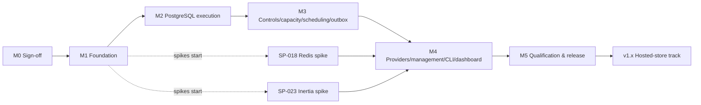

# Spindle v1 delivery plan — milestones, slices and tasks

Status: consolidated 2026-10-30 from the [implementation backlog](implementation-backlog.md), the [acceptance gates](architecture-acceptance.md) and every decision in the [review](review-2026-10-30.md). This is the single list to track. Task IDs are the backlog's SP numbers; nothing is renumbered. Sizes are relative (S ≈ days, M ≈ 1–2 weeks, L ≈ 3–5 weeks for one experienced engineer) and are planning aids, not commitments.

## 1. Milestone map

| Milestone | Gate | Outcome | Tasks |
|---|---|---|---|
| **M0 — Sign-off** | G-0 | Baseline approved with feature gates | SP-001 |
| **M1 — Foundation** | — | Compilable packages, test harness, registry/codec, PostgreSQL schema | SP-002, SP-003, SP-004, SP-005 |
| **M2 — PostgreSQL execution** | G-1 | First runnable system: dispatch → reserve → begin → execute → finish/recover, with fault evidence | SP-006, SP-007, SP-008, SP-009, SP-010 |
| **M3 — Distributed controls, capacity, scheduling, outbox** | G-2 | All five deployment modes; cancel/retry/rerun; transactional completion; rates; autoscaling; cron; outbox | SP-011, SP-012, SP-013, SP-014, SP-015, SP-016, SP-017 (+ spikes SP-018, SP-023 in parallel) |
| **M4 — Providers, management, CLI, dashboard** | G-3, G-4 | SQLite and Redis; management API; CLI; telemetry; dashboard; retention | SP-019, SP-020, SP-021, SP-022, SP-024, SP-025, SP-032 |
| **M5 — Qualification and release** | G-5, G-6 | Upgrades, deployment/security scenarios, driver reports, performance, packaging | SP-026, SP-027, SP-028, SP-029, SP-030 |
| **v1.x — Hosted-store track** | — | Protocol additions, cloud wire contract, `Spindle.Cloud` driver | SP-031, SP-033, SP-034 |

The first runnable milestone is **M2**. The hosted service itself (server tenancy, metering, billing, hosted dashboard) is a separate proprietary repository and is not in this plan.

## 2. M0 — Sign-off (G-0)

| ID | Task | Size | Depends on | Done when |
|---|---|---|---|---|
| SP-001 | Review the baseline and the 2026-10-30 review; record G-0 disposition | S | — | Decision log in the review shows no open items (it does); D-01–D-06, D-13 have first-milestone dispositions; later gates listed explicitly |

**G-0 is effectively complete**: every decision in the review's log is closed. Record the disposition as *approved with feature gates* and start M1.

## 3. M1 — Foundation

Slice 1.1 — *Skeleton that compiles*

| ID | Task | Size | Depends on | Done when |
|---|---|---|---|---|
| SP-002 | Solution and package scaffolding: `Spindle.Contracts`, `Spindle`, `Spindle.Postgres`, `Spindle.Sqlite`, `Spindle.Redis`, `Spindle.AspNetCore`, `Spindle.Dashboard`, `Spindle.Outbox(.Postgres/.Sqlite)`, `Spindle.Testing`, `Spindle.Cli`, `Spindle.OpenTelemetry`; pinned SDK (`global.json`), C# 14, central package versions (Npgsql 10.0.3, Microsoft.Data.Sqlite 10.0.14, StackExchange.Redis 3.4.20, Cronos 0.13.0, NodaTime 3.3.7 — recheck at creation); CI; attribute/fluent examples compile; NuGet name availability checked | M | SP-001 | Graph is acyclic; producer install pulls no web/provider/EF deps; examples from the API contract compile |

Slice 1.2 — *Test harness before features*

| ID | Task | Size | Depends on | Done when |
|---|---|---|---|---|
| SP-003 | Independent reference state model; fake-time engine fixture; real-store fault/barrier harness (`DriverFixture`: ArmFault, WaitAtBarrier, RestartStore); performance harness skeleton | L | SP-002 | Harness can drop a COMMIT reply, kill at a named point, hold a lock past lease expiry, run two processes against one store; reference model rejects illegal transitions |

Slice 1.3 — *Registry, serialization, schema*

| ID | Task | Size | Depends on | Done when |
|---|---|---|---|---|
| SP-004 | Immutable registration/policy registry (names, versions, upgrade chains, middleware aliases, precedence with source map); `spindle.json` v1 profile with bounds; canonical encoder + **two-digest** fingerprint (R3); prepared-dispatch codec and export envelope | L | SP-003 | SER-01–12 and wire vectors pass; identity conflicts rejected at startup; no runtime type loading from payload metadata |
| SP-005 | PostgreSQL schema and migration runner (advisory lock, ledger, expand/validate/activate phases); store/application gates; receipt table and codec (no Renew receipts, R1); capability/version handshake; transaction runner with fresh-time-after-locks and lock-order enforcement; `job_generations.created_reason`; two fingerprint columns on `dispatch_keys` | L | SP-003 | Fresh and interrupted initialization recover; PGX-05 constraints hold under injected rollback/commit loss; incompatible writers rejected; receipt insert uses `ON CONFLICT DO NOTHING` + `FOR UPDATE` |

## 4. M2 — PostgreSQL execution (G-1)

Slice 2.1 — *Dispatch*

| ID | Task | Size | Depends on | Done when |
|---|---|---|---|---|
| SP-006 | `DispatchAsync`, **`DispatchManyAsync` / `PrepareMany` / `StageManyAsync`**, active and window uniqueness with business/policy digests and `PolicyDrift`, `IPreparedJobDispatcher` (Prepare/Dispatch/Resolve), `StageAsync` on caller transaction, receipt resolution, `local_capacity_exceeded` | L | SP-004, SP-005 | CMD-01–05, UNI-01–04, TX-01–04 pass; lost COMMIT resolvable; rollback removes job and bindings; batch is all-or-nothing with per-ordinal results and `ContinueOnConflict` |

Slice 2.2 — *Ownership*

| ID | Task | Size | Depends on | Done when |
|---|---|---|---|---|
| SP-007 | Reserve with capability tuple filtering, `SKIP LOCKED`, multi-scope permits (queue/type/resource), fencing counters, bounded candidate scanning with cursor | M | SP-006 | ADM-01–05 pass across independent processes; all-or-none permits; unsupported versions never claimed; contention cost recorded |
| SP-008 | Begin (execution accounting), Renew (no receipt), Finish (outcome precedence, retry delay persisted once), Recover (expired-lease sweep, abandonment guard), **ReleaseReservation** (R2) | L | SP-007 | RUN-01–02, OWN-01–05, END-01, END-04, TIME-05/06 pass; replay never double-charges; stale owners cannot touch replacements; drain releases unbegun reservations immediately |

Slice 2.3 — *Worker engine*

| ID | Task | Size | Depends on | Done when |
|---|---|---|---|---|
| SP-009 | `WorkerHostedService`/supervisor; local tickets and attempt registry; readiness probe; pool coordinator with weighted lanes; attempt runner (decode/upgrade, DI scope, middleware pipeline with once-only `next`, outcome classification); lease coordinator with send-time safety deadline and watchdog; per-attempt arbiter; completion coordinator with bounded channel; recovery and presence loops; staged shutdown using ReleaseReservation; derived pressure gates (StopMargin/ResumeMargin); basic health | L | SP-004, SP-008 | Worker matrix passes with barriers; user code never runs inline on coordinator threads; uncertain claims/completions bound admission; TIME-01–04, 07–12 pass |

Slice 2.4 — *Prove it*

| ID | Task | Size | Depends on | Done when |
|---|---|---|---|---|
| SP-010 | First end-to-end PostgreSQL execution and fault report: rollback, death before/after Begin, stale Finish, dropped replies, ignored cancellation, shutdown at every phase; first P-01/P-02/P-08 measurements | M | SP-003, SP-006, SP-009 | **G-1 passes** for stated cases; limits explicit; baseline numbers recorded (expect two-round-trip and serial-claim ceilings; these justify SP-031) |

## 5. M3 — Distributed controls, capacity, scheduling, outbox (G-2)

Slice 3.1 — *Operator controls and exactly-once*

| ID | Task | Size | Depends on | Done when |
|---|---|---|---|---|
| SP-011 | Revisioned Cancel, ManualRetry, **RerunSucceeded**, queue pause/resume, scope policy edits; trusted actor; atomic `management_audit`; versioned event schema + keyset "events since cursor"; **transactional completion** `CompleteInTransactionAsync` for PostgreSQL/SQLite (R6); all five deployment modes verified | L | SP-010 | END-02/03, MGMT-04 pass; one receipt+audit per command; generation conflicts; caller rollback leaves attempt owned, commit finalizes exactly once |

Slice 3.2 — *Fairness, saturation, presence*

| ID | Task | Size | Depends on | Done when |
|---|---|---|---|---|
| SP-012 | Multi-lane readiness query; queue-wide saturation short-circuit; worker presence/capability records; "no capable worker" diagnostic; aging; cooldowns | M | SP-011 | CAP-01–04 pass; idle probe cost bounded per polling group; 10k blocked backlog does not cause per-job transactions |

Slice 3.3 — *Rates and scaling*

| ID | Task | Size | Depends on | Done when |
|---|---|---|---|---|
| SP-013 | Rolling-window rate scopes/grants; rate-aware Begin/1 with committed deferral; edit freeze; logical nondecreasing time; grant cleanup; operation-version gate rejecting old writers | M | SP-011 | RATE-01–04, CMD-06, CAP-05, PGX-03 pass |
| SP-014 | Local autoscaler (occupancy + allocated due backlog, EWMA service estimates, hysteresis with **min/max boundary rule** R4, cooldown, step limits, pressure freezes); revisioned pool overrides; scaling history | M | SP-012, SP-013 | CAP-06–08 pass; deterministic target traces (4→…→16 reaches 16) |

Slice 3.4 — *Scheduling*

| ID | Task | Size | Depends on | Done when |
|---|---|---|---|---|
| SP-015 | Versioned cron grammar (`spindle.cron5.v1`/`cron6.v1`), Cronos OR-union adapter, NodaTime zone mapping with pinned TZDB artifact + hash, gap/fold policies, bounded planner, preview | M | SP-004 | SCHED-01–08, 14 pass as pure tests |
| SP-016 | Schedule records; atomic materialization (occurrence + jobs + cursor + receipt); misfire episodes (skip/run-once/catch-up); manual trigger; pause/resume/edit cutover; needs_review and RevalidateSchedule; serialize overlap via schedule scope | L | SP-011, SP-013, SP-015 | SCH-01–05, SCHED-09–13, 15 pass across replicas |

Slice 3.5 — *Outbox*

| ID | Task | Size | Depends on | Done when |
|---|---|---|---|---|
| SP-017 | `Spindle.Outbox` relay; PostgreSQL and SQLite source adapters (Stage, Claim, Renew, MarkDelivered, Block); `ReceiveOutbox/1` destination op with delivery identity and 7-day horizon | M | SP-006 | OUTBOX-01–07, OUT-01–02 pass; lost delivered-mark recovers to the same job |

Parallel spikes (start as soon as dependencies allow; results feed M4):

| ID | Task | Size | Depends on | Done when |
|---|---|---|---|---|
| SP-018 | Redis prototype: same-slot layout, recoverable intent, failure after every write, AOF-always profile confirmation, reconnect/replay | M | SP-003, SP-004 | REDIS-01–06 on the prototype; go/revise decision recorded; failure keeps Redis unavailable without blocking PostgreSQL |
| SP-023 | Inertia.Net 1.5.3 + React SPA (no SSR) integration spike: mount isolation, two hosts, existing-host Inertia, auth/CSRF/CSP/path-base/assets | S–M | SP-002 | DASH-01–07 pass, or the specified adapter-extension/transport fallback is selected |

## 6. M4 — Providers, management, CLI, dashboard (G-3, G-4)

Slice 4.1 — *Management surface*

| ID | Task | Size | Depends on | Done when |
|---|---|---|---|---|
| SP-020 | Management application services behind transport-free `IManagementSession`; **public versioned management API** (ASP.NET Core); Basic/host/OIDC; antiforgery; keyset queries with signed cursors; bulk controls; reveal with disclosure audit; request limits | L | SP-011, SP-012, SP-014, SP-016 | MGMT-01–05, 07–10 pass; standalone host runs without workers |
| SP-032 | `Spindle.Cli` (`dotnet tool` + single-file): login/context, jobs/queues/schedules/workers/capacity/dispatch/events, migrate/doctor; human output, `--output json`, and the distinct **`--agent`** contract with `--agent describe` manifest; `--expected-revision`/`--command-id` everywhere | M | SP-020 | Every MGMT control drivable from the CLI against self-hosted; replayed commands resolve by receipt; agent envelopes validate against their schema |

Slice 4.2 — *Retention and telemetry*

| ID | Task | Size | Depends on | Done when |
|---|---|---|---|---|
| SP-021 | Dependency-aware retention/cleanup (resumable keyset batches, record-class horizons, detail-expired projections, receipt partition/class cleanup) | M | SP-011, SP-013, SP-016 | RET-01, MGMT-11, OPS-02/04/05 pass; live receipts/grants/windows/fences never pruned |
| SP-022 | `ActivitySource`/`Meter` "Spindle" with the frozen instrument/span/log tables; redaction; role health/readiness; bounded samplers; `Spindle.OpenTelemetry` (`AddSpindleInstrumentation()`, views, cardinality limits); pinned messaging-convention mapping; shipped Grafana dashboard + alert rules | M | SP-009, SP-012, SP-014, SP-016 | OBS-01–11 pass; no exporter dependency; stale snapshots never read as zero |

Slice 4.3 — *Dashboard*

| ID | Task | Size | Depends on | Done when |
|---|---|---|---|---|
| SP-024 | Embedded/standalone dashboard (Inertia.Net SPA, prebuilt assets): jobs/attempts, queues, workers/capacity, schedules, scaling, settings, retention, audit; polling | L | SP-020, SP-022, SP-023 | MGMT-01–12 across all response paths; DASH-01–07 against the real UI |

Slice 4.4 — *Other drivers*

| ID | Task | Size | Depends on | Done when |
|---|---|---|---|---|
| SP-019 | SQLite provider: bounded executor, `BEGIN IMMEDIATE`, same-host multi-process, transaction staging, `synchronous=FULL` profile | L | SP-010, SP-011, SP-013, SP-016 | Full applicable contract suite with real separate processes; network-file topology rejected |
| SP-025 | Full Redis provider on the accepted SP-018 design: execution, schedules, audit, retention, outbox destination, bounded projections | L | SP-013, SP-016, SP-018, SP-020, SP-021 | Applicable contract suite on the AOF-always profile; certification pending SP-028 |

## 7. M5 — Qualification and release (G-5, G-6)

| ID | Task | Size | Depends on | Done when |
|---|---|---|---|---|
| SP-026 | Upgrade/rollback matrix, migration tooling, drain/maintenance modes, restore runbook, scheduler profile/data cutovers | M | SP-005, SP-013, SP-016, SP-021 | UPG-01–10 pass; rollback floor and history-discontinuity limits documented |
| SP-027 | Integrated scenarios and samples: five deployments on each profile, auth modes, schedules/capacity, drain/outage, outbox; samples compile and run | M | SP-014, SP-016, SP-017, SP-019, SP-022, SP-024, SP-025, SP-026 | Every scenario has an executable sample and a passing run |
| SP-028 | Driver/profile conformance reports (PostgreSQL, SQLite, Redis) with no hidden skips | M | SP-003, SP-027 | **G-4 passes**: every mandatory applicable case has a result; unsupported capabilities fail explicitly |
| SP-029 | Performance/contention/recovery/soak qualification against P-01–P-10 and D-14 thresholds | L | SP-010, SP-014, SP-016, SP-021, SP-022, SP-024, SP-025 | Thresholds met or explicit recorded revision; 24 h soak shows bounded growth |
| SP-030 | Release packaging, licensing/dependency checks, documentation (at-least-once, cooperative cancellation, transactional-completion exactly-once, topology limits), defaults match code | M | SP-028, SP-029 | **G-6 passes**; v1 published |

## 8. v1.x — Hosted-store track

Starts after G-6. SP-031 benefits self-hosted users directly and may begin during M5 if capacity allows.

| ID | Task | Size | Depends on | Done when |
|---|---|---|---|---|
| SP-031 | Versioned protocol additions: `ReserveAndBegin/1`, batched Reserve, batched Renew, `application`-kind concurrency scope, `QuotaExceeded`, push-assignment hint channel alongside pull | M | SP-008, SP-011, SP-013 | Combined op preserves accounting and rate semantics; batch failures isolated per lease; old versions cannot bypass the application ceiling |
| SP-033 | Cloud wire contract: gRPC operation set, pull and push delivery, per-environment API-key scopes, tenant/store binding, reconnect rules | L | SP-031, SP-028 | Contract vectors for every operation; disconnect at every boundary resolves old commands; cross-tenant ISO cases pass |
| SP-034 | `Spindle.Cloud` client driver passing the shared contract suite against a reference server; `StageAsync` explicitly unsupported; outbox as dispatch path | L | SP-033 | Driver report with topology "hosted" |

Server-side tenancy, metering (runs by `created_reason`, 5 free manual retries, concurrency slots, retention tiers), billing and the hosted dashboard are tracked in the proprietary repository.

## 9. Critical path and parallelism

Critical path: SP-002 → SP-003 → SP-004/005 → SP-006 → SP-007 → SP-008 → SP-009 → SP-010 → SP-011 → SP-016 → SP-020 → SP-024 → SP-027 → SP-028/029 → SP-030.

Can run in parallel once their inputs exist:

- SP-004 and SP-005 (after SP-003).
- SP-015 (after SP-004) — pure evaluator work, independent of the engine.
- SP-018 and SP-023 spikes (after SP-003/SP-002).
- SP-012, SP-013, SP-017 (after SP-011/SP-006) with each other.
- SP-019, SP-021, SP-022, SP-032 (after their dependencies) with each other.
- SP-025 after SP-018 and SP-020, alongside SP-024.
- SP-026 specification early; evidence as components land.

Rough sequencing for one engineer: M1 ≈ 6–8 weeks, M2 ≈ 8–10 weeks, M3 ≈ 10–12 weeks, M4 ≈ 10–14 weeks, M5 ≈ 6–8 weeks — roughly 10–12 months to v1 solo; a second engineer taking the driver/dashboard/CLI lanes (SP-018/019/023/024/025/032) shortens M3–M4 substantially. These are planning ranges, not estimates of record.

## 10. Definition of done per gate

| Gate | Passes when |
|---|---|
| G-0 | Review decision log has no open items; disposition recorded |
| G-1 | SP-010 report: rollback, death before/after Begin, stale Finish, dropped replies, ignored cancellation, shutdown phases all preserve specified history; first measurements recorded |
| G-2 | Five deployments demonstrated; revisioned controls and audit race tests; bounded readiness/fairness; rate grant/defer/edit across replicas; scaler traces; cron/DST/materialization/misfire; outbox contract |
| G-3 | Basic/host/OIDC embedded and standalone; every protected path enforces authz/antiforgery; audit atomic with changes; adapter isolation tests; dashboard areas within budgets; CLI parity |
| G-4 | PostgreSQL, SQLite, Redis each have a full conformance report with no hidden skips |
| G-5 | Telemetry with absent exporters; global counts not multiplied; bounded resumable cleanup; upgrade matrix per driver; runbooks executable |
| G-6 | G-1–G-5 pass; P-01–P-10 within budgets; examples run; packages/licenses checked; documentation matches at-least-once, cooperative cancellation and transactional-completion semantics |

## 11. Tracking

Each task produces the acceptance report described in the backlog (§1): design revision, commit, environment/profile, case IDs with results, injected faults, limits, reviewer, date. Status moves not-started → in-progress → review-ready → accepted only with that evidence. Reopen a design only for a concrete contradiction, failed test, measured budget miss or changed requirement.
